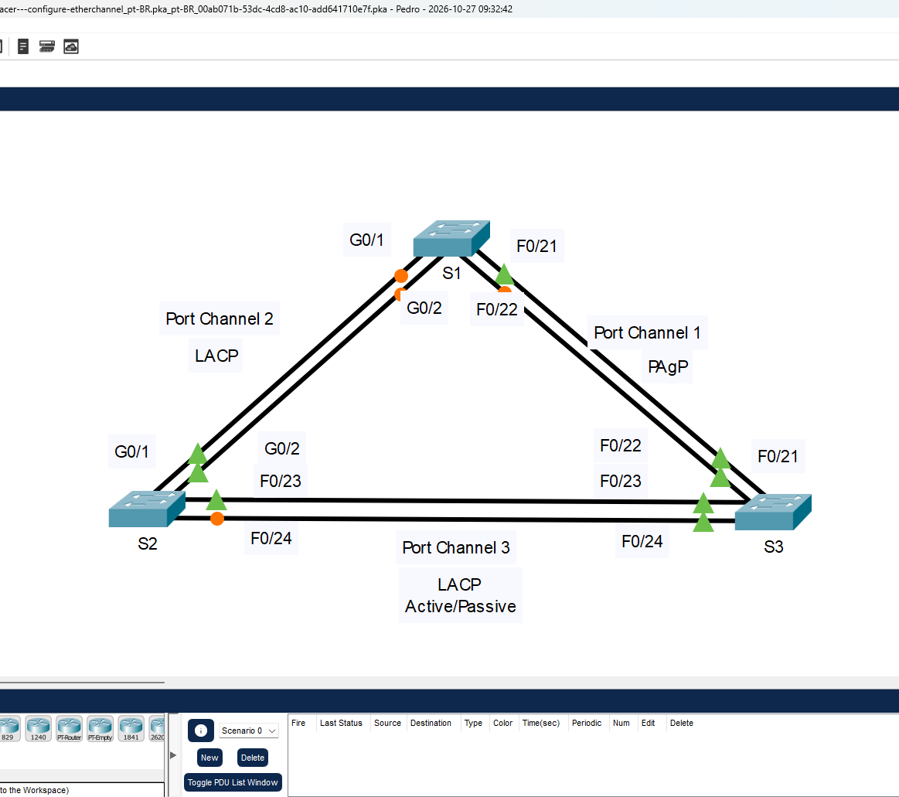
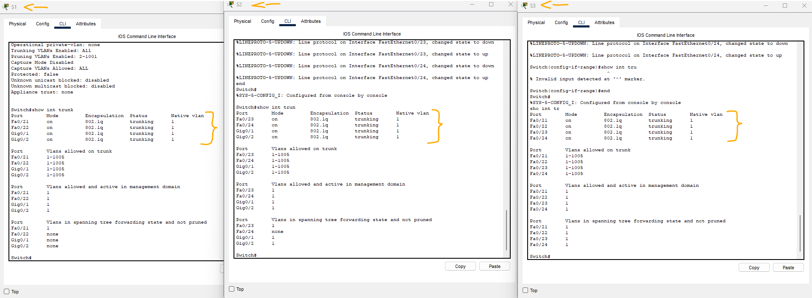
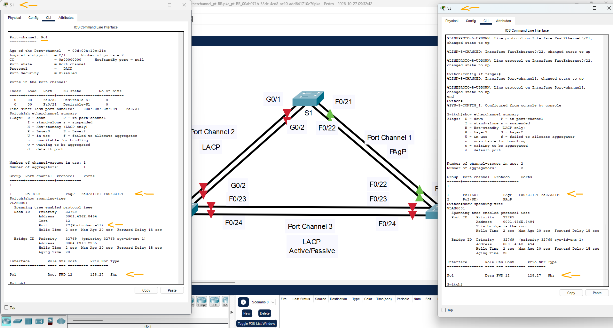
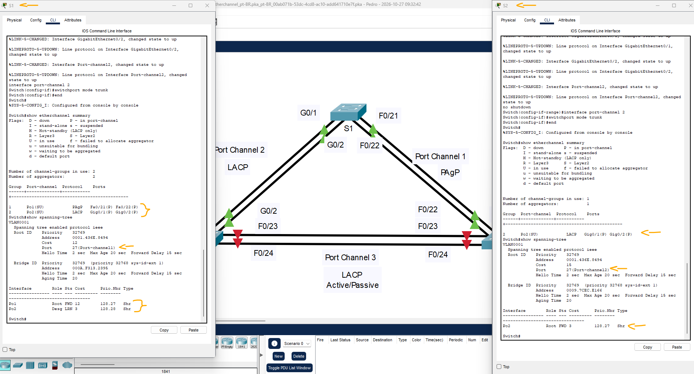
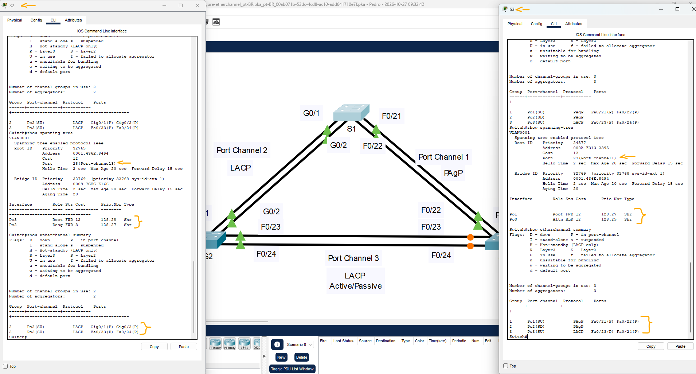

# Packet Tracer - Configuração do EtherChannel   

### Cisco: <a href="../../../">cisco   </a>
### Cisco Networking Academy: cna   </a>
### Training Category: <a href="../../../pkt/">pkt</a>
### Software/Subject: network   </a>
### Course: <a href="./">pkt_113 (Packet Tracer - Configuração do EtherChannel)   </a>

---

### Theme:
- Network

### Used Tools:
- Operating System (OS): 
  - Windows 11 
- Cloud Services:
  - Google Drive 
- Language:
  - HTML   
  - Markdown   
- Integrated Development Environment (IDE) and Text Editor:
  - Visual Studio Code (VS Code)   
- Versioning: 
  - Git   
- Repository:
  - GitHub   
- Network:
  - Cisco Packet Tracer   
  - ping   
  - traceroute   
  - Trace Route (tracert)   

---

<h3><a name="item00">Course Strcuture:</a></h3>

1. <a href="#item01">Parte 1: Configurar as definições básicas do Switch</a> 
2. <a href="#item02">Parte 2: Configurar um EtherChannel com Cisco PAgP</a> 
  2.1 <a href="#item02.01">Etapa 1: Configurar o Port Channel 1.</a> 
  2.2 <a href="#item02.02">Etapa 2: Verifique o status do Port Channel 1.</a> 
3. <a href="#item03">Parte 3: Configurar um EtherChannel 802.3ad LACP</a> 
  3.1 <a href="#item03.01">Etapa 1: Configure o Port Channel 2.</a> 
  3.2 <a href="#item03.02">Etapa 2: Verifique o status do Port Channel 2.</a> 
4. <a href="#item04">Parte 4: Configurar um link EtherChannel redundante</a> 
  4.1 <a href="#item04.01">Etapa 1: Configure o Port Channel 3.</a> 
  4.2 <a href="#item04.02">Etapa 2: Verifique o status do Port Channel 3.</a> 
5. <a href="#item05">Diretrizes e restrições de configuração do EtherChannel</a> 

---

### Objective:
O objetivo desta atividade foi construir uma pequena Rede Local (LAN), conectando os dispositivos finais aos dispositivos de rede, configurando o endereçamento IPv4 e verificando a conectividade por meio de testes de comunicação.

### Folder Structure:
- [README.md](./README.md): Este documento de README, escrito em **Markdown**, com o conteúdo do laboratório.
- [0-aux](./0-aux/): Pasta auxiliar com imagens utilizadas na construção dos arquivos de README desse curso.

### Development:

<a name="item01"><h4>1. Parte 1: Configurar as definições básicas do Switch</h4></a>[Back to summary](#item00)

A imagem 01 mostra a topologia inicial.

<figure>
     
    <figcaption>Imagem 01.</figcaption>
</figure>
 

- a. Atribuir a cada switch um hostname de acordo com o diagrama de topologia. 
- b. Antes de iniciar a agregação de link entre switches, verifique a configuração existente das portas que conectam os switches para garantir que as portas se juntem com êxito aos EtherChannels. Os comandos que fornecem informações sobre o estado das portas do switch incluem:
  - `show interface | include Ethernet` -> `show interface status` -> `show interfaces trunk`.
- c. Configure todas as portas necessárias para os EtherChannels como portas de tronco estático.
  - 
- c. Observação:Se as portas estiverem configuradas com o modo automático dinâmico de DTP e você não definir o modo das portas como tronco, os links não formarão troncos e permanecerão como portas de acesso. O modo padrão em um switch 2960 é que o DTP seja ativado e definido como dinâmico automático. O DTP pode ser desativado em interfaces com o comando switchport nonegotiate.

A imagem 02 exibe todas as conexões estabelecidas.

<figure>
     
    <figcaption>Imagem 02.</figcaption>
</figure>
 

<a name="item02"><h4>2. Parte 2: Configurar um EtherChannel com Cisco PAgP</h4></a>[Back to summary](#item00)

- a. Observação: Ao configurar o EtherChannels, é recomendável desligar as portas físicas que estão sendo agrupadas nos dois dispositivos antes de configurá-las em grupos de canais. Caso contrário, o EtherChannel Misconfig Guard poderá colocar essas portas no estado desabilitado por erro. As portas e os port channels podem ser ativados novamente após o EtherChannel ser configurado.

<a name="item02.01"><h4>2.1 Etapa 1: Configurar o Port Channel 1.</h4></a>[Back to summary](#item00)

- a. O primeiro EtherChannel criado para esta atividade agrega as portas F0/21 e F0/22 entre S1 e S3. Configure as portas nos dois switches como portas de tronco estáticas. 
- b. Use o comando show interfaces trunk para garantir que você tenha um link de tronco ativo para esses dois links e a VLAN nativa nos dois links seja a mesma.
  - `show interfaces trunk`.
- c. Em S1 e S3, adicione as portas F0/21 e F0/22 ao Canal de Porta 1 com o comando channel-group 1 mode desirable. A opção mode desirable permite que o switch negocie ativamente para formar um link PAgP. Observação: as interfaces devem ser desativadas antes de adicioná-las ao grupo de canais.
  - `interface range f0/21 - 22` -> `shutdown` -> `channel-group 1 mode desirable` -> `no shutdown`.
  - `interface range f0/21 - 22` -> `shutdown` -> `channel-group 2 mode desirable` -> `no shutdown`.
- c. A mensagem “Criando uma interface de canal de porta Canal 1” deve aparecer em ambos os switches quando o grupo de canais estiver configurado. Esta designação de interface aparecerá como Po1 na saída de comando.
- d. Configure a interface lógica para se tornar um tronco digitando primeiro o comando interface port-channel number e então o comando switchport mode trunk. Adicione esta configuração a ambos os switches.
  - `interface port-channel 1` -> `switchport mode trunk` -> `interface port-channel 1` -> `switchport mode trunk`.

<a name="item02.02"><h4>2.2 Etapa 2: Verifique o status do Port Channel 1.</h4></a>[Back to summary](#item00)

- a. Insira o comando show etherchannel summary em S1 e S3 para verificar se o EtherChannel está funcionando nos dois comutadores. Este comando exibe o tipo de EtherChannel, as portas utilizadas e os estados da porta. A saída do comando é mostrada para S1.
  - `show etherchannel summary`.
- b. Se o EtherChannel não for ativado, feche as interfaces físicas nas duas extremidades do EtherChannel e ative-as novamente. Os comandos show interfaces trunk e show spanning-tree deve mostrar o canal da porta como um link lógico.

A imagem 03 comprova que todos dispositivos finais foram corretamente endereçados.

<figure>
     
    <figcaption>Imagem 03.</figcaption>
</figure>
 

<a name="item03"><h4>3. Parte 3: Configurar um EtherChannel 802.3ad LACP</h4></a>[Back to summary](#item00)

<a name="item03.01"><h4>3.1 Etapa 1: Configure o Port Channel 2.</h4></a>[Back to summary](#item00)

- a. Em 2000, o IEEE lançou o 802.3ad, que é uma versão padrão aberta do EtherChannel. É comumente referido como LACP. Usando os comandos anteriores, configure o link entre S1 e S2, usando as portas G0/1 e G0/2, como um LACP EtherChannel. Você deve usar um número de canal de porta diferente em S1  do que 1, porque você já usou isso na etapa anterior. Para configurar o canal da porta 2 como LACP, use o comando interface configuration mode channel-group 2 mode active . O modo ativo indica que o switch tenta negociar ativamente esse link como LACP, em oposição ao PAgP. A configuração do S1 é mostrada abaixo.
  - `interface range g0/1 - 2` -> `shutdown` -> `channel-group 2 mode active` -> `no shutdown` -> `interface port-channel 2` -> `switchport mode trunk`.

<a name="item03.02"><h4>3.2 Etapa 2: Verifique o status do Port Channel 2.</h4></a>[Back to summary](#item00)

- a. Use os comandos show da Etapa 2 da Parte 1 para verificar o status do Port Channel 2. Procure o protocolo usado em cada porta.
  - 

A imagem 04 mostra o servidor web sendo acessado por meio do endereço IP e o teste de conectividade realizado com êxito entre o Admin PC e a impressora.

<figure>
     
    <figcaption>Imagem 04.</figcaption>
</figure>
 

<a name="item04"><h4>4. Parte 4: Configurar um link EtherChannel redundante</h4></a>[Back to summary](#item00)

<a name="item04.01"><h4>4.1 Etapa 1: Configure o Port Channel 3.</h4></a>[Back to summary](#item00)

- a. Existem várias opções para o comando channel-group number mode:
  - `interface range f0/23 - 24` -> `channel-group 3 mode ?`.
- a. No switch S2, adicione as portas F0/23 e F0/24 ao Port Channel 3 com o comando channel-group 3 mode passive. A opção passive indica que você deseja que o switch use LACP somente se outro dispositivo LACP for detectado. Configure estaticamente o Port Channel 3 como uma interface de tronco.
  - `interface range f0/23 - 24` -> `shutdown` -> `channel-group 3 mode passive` -> `no shutdown` -> `interface port-channel 3` -> `switchport mode trunk`.
- b. No S3, adicione as portas F0/23 e F0/24 para Port Channel 3 com o comando channel-group 3 mode active. A opção active indica que você deseja que o switch use o LACP de modo incondicional. Configure estaticamente o Port Channel 3 como uma interface de tronco.

<a name="item04.02"><h4>4.2 Etapa 2: Verifique o status do Port Channel 3.</h4></a>[Back to summary](#item00)

- a. Use os comandos show da Etapa 2 da Parte 1 para verificar o status do Port Channel 3. Procure o protocolo usado em cada porta. 
- b. A criação de links EtherChannel não impede que a Spanning Tree detecte loops de switching. Exiba o status da árvore de abrangência das portas ativas no S1.
  - `show spanning-tree active`.
- b. O canal de porta 2 não está operacional porque o Spanning Tree Protocol colocou algumas portas no modo de bloqueio. Infelizmente, essas portas eram as portas Gigabit. Nesta topologia, você pode restaurar essas portas configurando S1 como raiz primária para VLAN 1. Você também pode definir a prioridade para 24576.
  - `spanning-tree vlan 1 root primary` -> `spanning-tree vlan 1 priority 24576`.
- b. Talvez seja necessário aguardar o STP recalcular a topologia da árvore. Pressione para a frente, se necessário. Use o comando show spanning-tree active para verificar se as portas Gigabit estão agora no estado de encaminhamento.

A imagem 05 exibe o caminho percorrido pelos pacotes até o servidor web, indicando os roteadores atravessados durante o trajeto.

<figure>
     
    <figcaption>Imagem 05.</figcaption>
</figure>
 

<a name="item05"><h4>5. Diretrizes e restrições de configuração do EtherChannel</h4></a>[Back to summary](#item00)

O EtherChannel tem algumas diretrizes específicas que devem ser seguidas para evitar problemas de configuração. 
1) Todas as interfaces Ethernet suportam EtherChannel até um máximo de oito interfaces sem necessidade de que as interfaces estejam no mesmo módulo de interface. 
2) Todas as interfaces dentro de um EtherChannel devem operar na mesma velocidade e duplex. 
3) Os links EtherChannel podem funcionar como portas de acesso VLAN simples ou como links de tronco entre switches. 
4) Todas as interfaces em um EtherChannel de Camada 2 devem ser membros da mesma VLAN ou ser configuradas como troncos. 
5) Se configurado como links de tronco, o EtherChannel da Camada 2 deverá ter a mesma VLAN nativa e ter as mesmas VLANs permitidas em ambos os switches conectados ao tronco. 
6) Ao configurar links EtherChannel, todas as interfaces devem ser desativadas antes de iniciar a configuração do EtherChannel.  Quando a configuração estiver concluída, os links podem ser reativados. 
7) Depois de configurar o EtherChannel, verifique se todas as interfaces estão no estado up/up. 
8) É possível configurar um EtherChannel como estático, ou para que ele use PAgP ou LACP para negociar a conexão EtherChannel.  A determinação de como um EtherChannel é configurado é o valor do comando channel group number mode.  Os valores válidos são:
- active: LACP é ativado incondicionalmente 
- passive: LACP passivo é ativado somente se outro dispositivo compatível com LACP estiver conectado.  
- desirable: PAgP é ativado incondicionalmente.
- auto: PAgP é ativado somente se outro dispositivo compatível com PAgP estiver conectado.  
- no: EtherChannel está habilitado, mas sem LACP ou PAgP.
9) As portas LAN podem formar um EtherChannel usando PAgP se os modos forem compatíveis. Os modos PAgP compatíveis são: 
- desejável => desejável 
- desejável => auto 
- Se ambas as interfaces estiverem no modo automático, não será possível formar um Etherchannel.
10) As portas LAN podem formar um EtherChannel usando LACP se os modos forem compatíveis. Os modos LACP compatíveis são: 
- active => active 
- active => passivo 
- Se ambas as interfaces estiverem no modo passivo, um EtherChannel não poderá formar usando LACP. 
11) Os números de grupos de canais são locais para o switch individual. Embora essa atividade use o mesmo número de grupo de canais em qualquer extremidade da conexão EtherChannel, ela não é um requisito. Channel-group 1 (interface po1) em um switch pode formar um EtherChannel com Channel-group 5 (interface po5) em outro switch.

