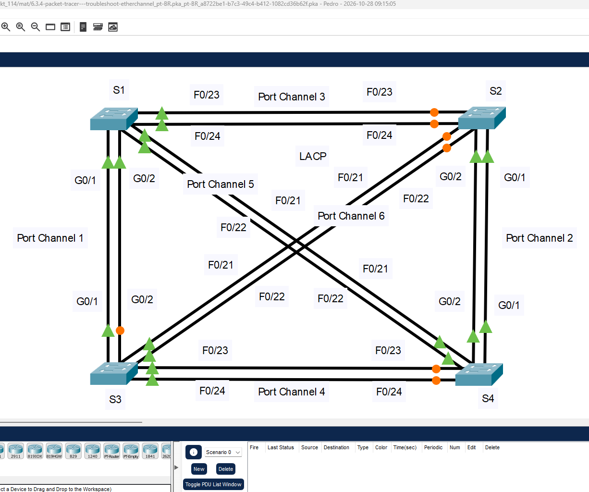
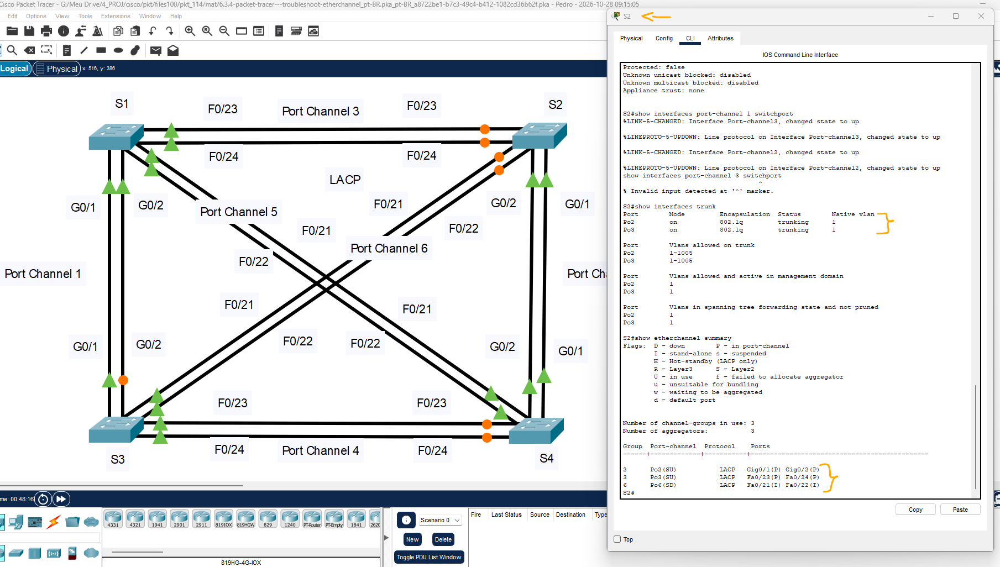
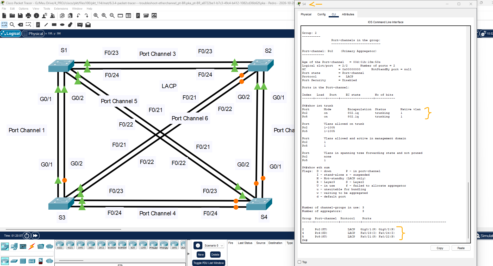
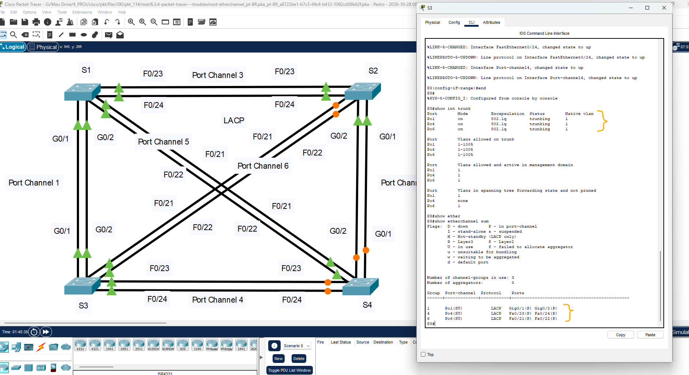

# Packet Tracer - Pesquise defeitos o EtherChannel   

### Cisco: <a href="../../../">cisco   </a>
### Cisco Networking Academy: cna   </a>
### Training Category: <a href="../../../pkt/">pkt</a>
### Software/Subject: network   </a>
### Course: <a href="./">pkt_114 (Packet Tracer - Pesquise defeitos o EtherChannel)   </a>

---

### Theme:
- Network

### Used Tools:
- Operating System (OS): 
  - Windows 11 
- Cloud Services:
  - Google Drive 
- Language:
  - HTML   
  - Markdown   
- Integrated Development Environment (IDE) and Text Editor:
  - Visual Studio Code (VS Code)   
- Versioning: 
  - Git   
- Repository:
  - GitHub   
- Network:
  - Cisco Packet Tracer   

---

<h3><a name="item00">Course Strcuture:</a></h3>

1. <a href="#item01">Parte 1: Analise a camada física e corrija os problemas do modo de porta do switch</a> 
  1.1 <a href="#item01.01">Etapa 1: Procure as portas de acesso.</a> 
  1.2 <a href="#item01.02">Etapa 2: Verifique se as portas estão no modo de tronco.</a> 
2. <a href="#item02">Parte 2: Identificar e corrigir os problemas de atribuição de canal de porta</a> 
  2.1 <a href="#item02.01">Etapa 1: Analise as atribuições de canal de porta.</a> 
  2.2 <a href="#item02.02">Etapa 2: Corrija as atribuições de port channel.</a> 
3. <a href="#item03">Parte 3: Identifique e corrija os problemas do protocolo do port channel</a> 
  3.1 <a href="#item03.01">Etapa 1: Identifique problemas do protocolo.</a> 
  3.2 <a href="#item03.02">Etapa 2: Corrija os problemas do protocolo.</a> 

---

### Objective:
O objetivo desta atividade foi identificar e corrigir três tipos de problemas na configuração dos links EtherChannel: portas configuradas incorretamente no modo de operação, interfaces físicas atribuídas aos grupos EtherChannel errados e utilização de protocolos de negociação inadequados.

### Folder Structure:
- [README.md](./README.md): Este documento de README, escrito em **Markdown**, com o conteúdo do laboratório.
- [0-aux](./0-aux/): Pasta auxiliar com imagens utilizadas na construção dos arquivos de README desse curso.

### Development:

<a name="item01"><h4>1. Parte 1: Analise a camada física e corrija os problemas do modo de porta do switch</h4></a>[Back to summary](#item00)

A imagem 01 mostra a topologia inicial.

<figure>
     
    <figcaption>Imagem 01.</figcaption>
</figure>
 

<a name="item01.01"><h4>1.1 Etapa 1: Procure as portas de acesso.</h4></a>[Back to summary](#item00)

Analise os switches. Quando dois ou mais links redundantes conectam os mesmos switches, o protocolo Spanning Tree colocará apenas uma porta no modo de encaminhamento para evitar loops de switching. Você pode ver isso no Packet Tracer. Quando portas físicas são atribuídas a uma porta EtherChannel, elas se comportam como uma única porta. Cada par será operacional ou inativa.

<a name="item01.02"><h4>1.2 Etapa 2: Verifique se as portas estão no modo de tronco.</h4></a>[Back to summary](#item00)

- a. Verifique se todas as portas físicas na topologia estão configuradas como troncos. Corrija as portas que estão no modo de acesso.
  - S1 à S4: `enable` -> `show interface f0/21 switchport` -> `show interface f0/22 switchport` -> `show interface f0/23 switchport` -> `show interface f0/24 switchport` -> `show interface g0/1 switchport` -> `show interface g0/2 switchport`.
- b. Corrija quaisquer portas EtherChannel que não estejam configuradas como trunks.
  - S2: `configure terminal` -> `interface range f0/21-24,g0/1-2` -> `switchport mode trunk` -> `end`.

A imagem 02  mostra que as portas dos links EtherChannel no switch S2 foram corrigidas e configuradas no modo trunk. As interfaces do EtherChannel 6 não aparecem na saída do comando show interfaces trunk, pois esse link apresenta um problema adicional de configuração, que será corrigido nas próximas etapas.

<figure>
     
    <figcaption>Imagem 02.</figcaption>
</figure>
 

<a name="item02"><h4>2. Parte 2: Identificar e corrigir os problemas de atribuição de canal de porta</h4></a>[Back to summary](#item00)

<a name="item02.01"><h4>2.1 Etapa 1: Analise as atribuições de canal de porta.</h4></a>[Back to summary](#item00)

- a. A topologia do Rastreador de Pacotes e as tabelas Canal de Porta e Dispositivo fornecem detalhes sobre as portas físicas e suas atribuições EtherChannel. Use o comando show etherchannel summary para saber como os links do EtherChannel estão configurados. Verifique se os switches estão configurados conforme mostrado na documentação.
  - `show etherchannel summary`.

<a name="item02.02"><h4>2.2 Etapa 2: Corrija as atribuições de port channel.</h4></a>[Back to summary](#item00)

- a. Corrija qualquer porta de switch não atribuída à porta EtherChannel correta.
  - S4: `configure terminal` -> `interface range f0/21-22` -> `shutdown` -> `no channel-group` -> `channel-group 5 mode active` -> `no shutdown` -> `end`.

A imagem 03 exibe que as portas do EtherChannel 5 foram corrigidas e atribuídas ao grupo correspondente.

<figure>
     
    <figcaption>Imagem 03.</figcaption>
</figure>
 

<a name="item03"><h4>3. Parte 3: Identifique e corrija os problemas do protocolo do port channel</h4></a>[Back to summary](#item00)

<a name="item03.01"><h4>3.1 Etapa 1: Identifique problemas do protocolo.</h4></a>[Back to summary](#item00)

Em 2000, o IEEE lançou o 802.3ad (LADP), uma versão padrão do EtherChannel. Por motivos de compatibilidade, a equipe de design da rede optou por usar LACP em toda a rede. A equipe de design fez com que todas as portas que participam do EtherChannel precisem negociar ativamente o link como LACP. Verifique se as portas físicas estão configuradas conforme indicado na topologia e na tabela de canais de portas. 
  - `show etherchannel summary`.

<a name="item03.02"><h4>3.2 Etapa 2: Corrija os problemas do protocolo.</h4></a>[Back to summary](#item00)

- a. Corrija qualquer porta de switch não negociando com o uso de LACP.
  - S3: `configure terminal` -> `no interface port-channel 1` -> `interface range g0/1-2` -> `shutdown` -> `no channel-group` -> `channel-group 1 mode active` -> `no shutdown` -> `end`.
  - S3: `configure terminal` -> `no interface port-channel 4` -> `interface range f0/23-24` -> `shutdown` -> `no channel-group` -> `channel-group 4 mode active` -> `no shutdown` -> `end`.
  - S3: `configure terminal` -> `no interface port-channel 6` -> `interface range f0/21-22` -> `shutdown` -> `no channel-group` -> `channel-group 6 mode active` -> `no shutdown` -> `end`.
- b. Emita novamente o comando show etherchannel summary para verificar se todos os links do EtherChannel estão configurados corretamente.
  - `show etherchannel summary`.

A imagem 04 ilustra a configuração corrigida do switch S3, com os três links EtherChannel configurados para utilizar o protocolo LACP.

<figure>
     
    <figcaption>Imagem 04.</figcaption>
</figure>
 