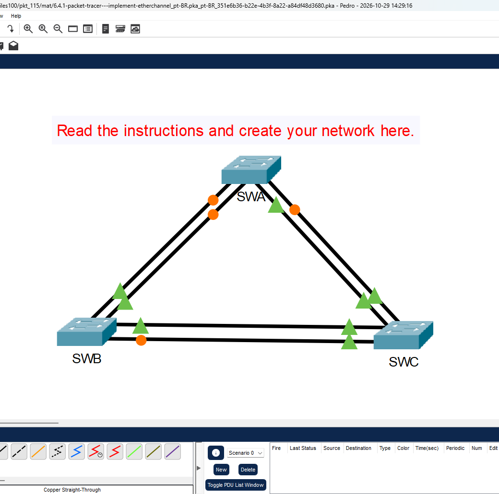
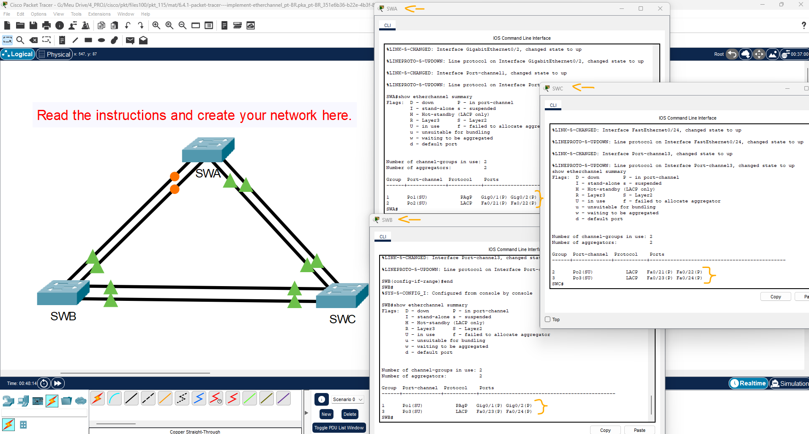

# Packet Tracer - Implementar EtherChannel   

### Cisco: <a href="../../../">cisco   </a>
### Cisco Networking Academy: cna   </a>
### Training Category: <a href="../../../pkt/">pkt</a>
### Software/Subject: network   </a>
### Course: <a href="./">pkt_115 (Packet Tracer - Implementar EtherChannel)   </a>

---

### Theme:
- Network

### Used Tools:
- Operating System (OS): 
  - Cisco Internetwork Operating System (Cisco IOS)   
  - Windows 11 
- Cloud Services:
  - Google Drive 
- Language:
  - HTML   
  - Markdown   
- Integrated Development Environment (IDE) and Text Editor:
  - Visual Studio Code (VS Code)   
- Versioning: 
  - Git   
- Repository:
  - GitHub   
- Network:
  - Cisco Packet Tracer   

---

<h3><a name="item00">Course Strcuture:</a></h3>

1. <a href="#item01">Parte 1: Criação da rede</a> 
  1.1 <a href="#item01.01">Etapa 1: Obtenha os dispositivos necessários.</a> 
  1.2 <a href="#item01.02">Etapa 2: Dê um nome aos dispositivos.</a> 
  1.3 <a href="#item01.03">Etapa 3: Conecte os dispositivos.</a> 
2. <a href="#item02">Parte 2: Configurar o EtherChannel</a> 
  2.1 <a href="#item02.01">Etapa 1: Configurar um PAgP EtherChannel.</a> 
  2.2 <a href="#item02.02">Etapa 2: Configure um EtherChannel do LACP.</a> 
  2.3 <a href="#item02.03">Etapa 3: Configurar um EtherChannel de LACP de backup</a> 

---

### Objective:
Esta atividade teve como objetivo implementar uma topologia de rede composta por três switches interconectados por enlaces redundantes, configurando um EtherChannel para cada par de switches e agregando as respectivas interfaces físicas para formar enlaces lógicos.

### Folder Structure:
- [README.md](./README.md): Este documento de README, escrito em **Markdown**, com o conteúdo do laboratório.
- [0-aux](./0-aux/): Pasta auxiliar com imagens utilizadas na construção dos arquivos de README desse curso.

### Development:

<a name="item01"><h4>1. Parte 1: Criação da rede</h4></a>[Back to summary](#item00)

Use a tabela abaixo para criar a topologia do switch.

<a name="item01.01"><h4>1.1 Etapa 1: Obtenha os dispositivos necessários.</h4></a>[Back to summary](#item00)

- a. Clique no ícone Dispositivos de Rede na barra de ferramentas inferior. 
- b. Clique na entrada Switches no submenu. 
- c. Localize o ícone do switch 2960. Clique e arraste o ícone do switch 2960 para a área de topologia. 
- d. Repita a etapa acima para que haja três switches 2960 na área de topologia. 
- e. Organize os dispositivos em um layout com o qual você pode trabalhar clicando e arrastando. 

<a name="item01.02"><h4>1.2 Etapa 2: Dê um nome aos dispositivos.</h4></a>[Back to summary](#item00)

Os dispositivos têm nomes padrão que você precisará alterar. Você nomeará os dispositivos SWA, SWB e SWC. Você está alterando os nomes de exibição dos dispositivos. Este é o rótulo de texto que aparece abaixo de cada dispositivo. Não é o nome do host. Seus nomes de exibição devem corresponder exatamenteaos nomes fornecidos nesta etapa. Se um nome de exibição não corresponder, você não será marcado para a configuração do dispositivo. 

- a. Clique no nome de exibição do dispositivo que está abaixo do ícone do dispositivo. Um campo de texto deve aparecer com um ponto de inserção intermitente. Se a janela de configuração do dispositivo for exibida, feche-a e tente novamente clicando um pouco mais longe do ícone do dispositivo. 
- b. Substitua o nome de exibição atual pelo nome de exibição apropriado.
  - SWA: `enable` -> `configure terminal` `hostname SWA`.
  - SWB: `enable` -> `configure terminal` `hostname SWB`.
  - SWC: `enable` -> `configure terminal` `hostname SWC`.
- c. Repita até que todos os dispositivos sejam nomeados. 

<a name="item01.03"><h4>1.3 Etapa 3: Conecte os dispositivos.</h4></a>[Back to summary](#item00)

- a. Clique no ícone Conexões de raio laranja na barra de ferramentas inferior.
- b. Localize o ícone de cabo direto Ethernet. Parece uma linha diagonal preta sólida.
- c. Para conectar o dispositivo, clique no ícone de cabo direto Ethernet e, em seguida, clique no primeiro dispositivo que você deseja conectar. Selecione a porta correta e clique no segundo dispositivo. Selecione a porta correta e os dispositivos serão conectados. 
- d. Conecte os dispositivos conforme especificado na tabela abaixo. 

A imagem 01 apresenta a topologia de rede montada conforme as especificações da atividade.

<figure>
     
    <figcaption>Imagem 01.</figcaption>
</figure>
 

<a name="item02"><h4>2. Parte 2: Configurar o EtherChannel</h4></a>[Back to summary](#item00)

Em cada switch, configure as portas que serão usadas nos Canais de Porta como portas de tronco estáticas.

<a name="item02.01"><h4>2.1 Etapa 1: Configurar um PAgP EtherChannel.</h4></a>[Back to summary](#item00)

- a. Siga o procedimento usado em atividades anteriores para configurar o Canal de Porta 1 como um EtherChannel PAgP entre SWA e SWB. Ambos os lados devem negociar o canal EtherChannel.
  - SWA: `interface range g0/1-2` -> `shutdown` -> `switchport mode trunk` -> `channel-group 1 mode desirable` -> `no shutdown` -> `end`.
  - SWB: `interface range g0/1-2` -> `shutdown` -> `switchport mode trunk` -> `channel-group 1 mode desirable` -> `no shutdown` -> `end`.

<a name="item02.02"><h4>2.2 Etapa 2: Configure um EtherChannel do LACP.</h4></a>[Back to summary](#item00)

- a. Configure o Canal de Porta 2 como um canal LACP entre SWA e SWC. Ambos os lados devem negociar o canal EtherChannel.
  - SWA: `interface range f0/21-22` -> `shutdown` -> `switchport mode trunk` -> `channel-group 2 mode active` -> `no shutdown` -> `end` -> `show etherchannel summary`.
  - SWC: `interface range f0/21-22` -> `shutdown` -> `switchport mode trunk` -> `channel-group 2 mode active` -> `no shutdown` -> `end`.

<a name="item02.03"><h4>2.3 Etapa 3: Configurar um EtherChannel de LACP de backup</h4></a>[Back to summary](#item00)

- a. Configure o canal de porta 3 como um canal LACP entre SWB e SWC. Nesse caso, o SWC inicia a negociação com o SWB. SWB não inicia a negociação do canal.
  - SWB: `interface range f0/23-24` -> `shutdown` -> `switchport mode trunk` -> `channel-group 3 mode passive` -> `no shutdown` -> `end` -> `show etherchannel summary`.
  - SWC: `interface range f0/23-24` -> `shutdown` -> `switchport mode trunk` -> `channel-group 3 mode active` -> `no shutdown` -> `end` -> `show etherchannel summary`.

A imagem 02 mostra as interfaces de cada switch configuradas e associadas aos respectivos grupos EtherChannel.

<figure>
     
    <figcaption>Imagem 02.</figcaption>
</figure>
 