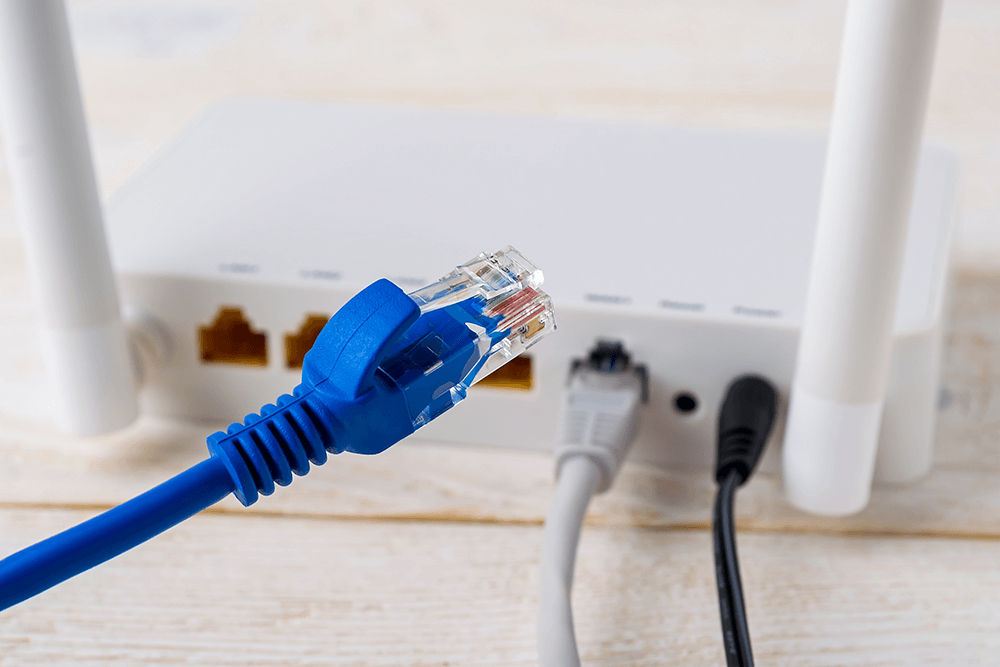

# Networking Basics   

### Cisco: <a href="../../">cisco   </a>
### Cisco Networking Academy: cna   </a>
### Training Category: <a href="../../self_paced/">self-paced</a>
### Software/Subject: cybersecurity   </a>
### Course: <a href="./">sfp_007 (Networking Basics)   </a>

#### <a href="https://github.com/PedroHeeger/my_tech_journey/blob/main/credentials/certificates/online_courses/network/cisco/261115_Cert_sfp_007_PH_CNA.pdf">Certificate</a>
#### <a href="https://www.credly.com/badges/e71ea3ae-6028-4c35-82cb-317abf421e19">Badge</a>

---

### Theme:
- Network

### Used Tools:
- Operating System (OS): 
  - Windows 11 
- Cloud Services:
  - Google Drive 
- Language:
  - HTML   
  - Markdown   
- Integrated Development Environment (IDE) and Text Editor:
  - Visual Studio Code (VS Code)   
- Versioning: 
  - Git   
- Repository:
  - GitHub   

---

### Course Strcuture:
1. <a href="./mod-01/">Comunicação em um Mundo Conectado</a> 
  1.1 <a href="./mod-01/README.md#item01.01">Introdução</a> 
  1.2 <a href="./mod-01/README.md#item01.02">Tipos de Rede</a> 
  1.3 <a href="./mod-01/README.md#item01.03">Transmissão de Dados</a> 
  1.4 <a href="./mod-01/README.md#item01.04">Largura de banda e taxa de transferência</a> 
  1.5 <a href="./mod-01/README.md#item01.05">Resumo Comunicação em um mundo conectado</a> 
2. <a href="./mod-02/">Componentes, tipos e conexões de rede</a> 
  2.1 <a href="./mod-02/README.md#item02.01">Introdução</a> 
  2.2 <a href="./mod-02/README.md#item02.02">Clientes e Servidores</a> 
  2.3 <a href="./mod-02/README.md#item02.03">Componentes de rede</a> 
  2.4 <a href="./mod-02/README.md#item02.04">Opções de conectividade com o ISP</a> 
  2.5 <a href="./mod-02/README.md#item02.05">Resumo de componentes de rede, tipos e conexões</a> 
3. <a href="./mod-03/">Redes sem fio e móveis</a> 
  3.1 <a href="./mod-03/README.md#item03.01">Introdução</a> 
  3.2 <a href="./mod-03/README.md#item03.02">Redes Wireless</a> 
  3.3 <a href="./mod-03/README.md#item03.03">Conectividade de dispositivo móvel</a> 
  3.4 <a href="./mod-03/README.md#item03.04">Resumo de redes sem fio e móveis</a> 
4. <a href="./mod-04/">Construindo uma Rede Doméstica</a> 
  4.1 <a href="./mod-04/README.md#item04.01">Introdução</a> 
  4.2 <a href="./mod-04/README.md#item04.02">Conceitos básicos da rede doméstica</a> 
  4.3 <a href="./mod-04/README.md#item04.03">Tecnologias de rede na residência</a> 
  4.4 <a href="./mod-04/README.md#item04.04">Padrões de Redes Sem Fio</a> 
  4.5 <a href="./mod-04/README.md#item04.05">Configurar um roteador doméstico</a> 
  4.6 <a href="./mod-04/README.md#item04.06">Resumo Construindo uma Rede Doméstica</a> 
  4.7 Exame de ponto de verificação: Construir uma pequena rede 
5. <a href="./mod-05/">Princípios de comunicação</a> 
  5.1 <a href="./mod-05/README.md#item05.01">Introdução</a> 
  5.2 <a href="./mod-05/README.md#item05.02">Protocolos de comunicação</a> 
  5.3 <a href="./mod-05/README.md#item05.03">Padrões de comunicação</a> 
  5.4 <a href="./mod-05/README.md#item05.04">Modelos de comunicação de rede</a> 
  5.5 <a href="./mod-05/README.md#item05.05">Resumo dos Princípios de comunicação</a> 
6. <a href="./mod-06/">Mídia de rede</a> 
  6.1 <a href="./mod-06/README.md#item06.01">Introdução</a> 
  6.2 <a href="./mod-06/README.md#item06.02">Tipos de Mídia de Rede</a> 
  6.3 <a href="./mod-06/README.md#item06.03">Resumo - Mídia de rede</a> 
7. <a href="./mod-07/">A Camada de Acesso</a> 
  7.1 <a href="./mod-07/README.md#item07.01">Introdução</a> 
  7.2 <a href="./mod-07/README.md#item07.02">Encapsulamento e o quadro Ethernet</a> 
  7.3 A Camada de Acesso 
  7.4 <a href="./mod-07/README.md#item07.04">Resumo: Camada de Acesso</a> 
  7.5 Exame de ponto de verificação: acesso à rede 
8. <a href="./mod-08/">Protocolo de Internet (Internet Protocol - IP)</a> 
  8.1 <a href="./mod-08/README.md#item08.01">Introdução</a> 
  8.2 <a href="./mod-08/README.md#item08.02">Finalidade de um endereço IPv4</a> 
  8.3 <a href="./mod-08/README.md#item08.03">A estrutura do endereço IPv4</a> 
  8.4 <a href="./mod-08/README.md#item08.04">Resumo Protocolo IP</a> 
9. <a href="./mod-09/">IPv4 e segmentação de rede</a> 
  9.1 <a href="./mod-09/README.md#item09.01">Introdução</a> 
  9.2 <a href="./mod-09/README.md#item09.02">Unicast, broadcast e multicast IPv4</a> 
  9.3 <a href="./mod-09/README.md#item09.03">Tipos de endereços IPv4</a> 
  9.4 <a href="./mod-09/README.md#item09.04">Segmentação de rede</a> 
  9.5 <a href="./mod-09/README.md#item09.05">Resumo - IPv4 e segmentação de rede</a> 
10. <a href="./mod-10/">Formatos e regras de endereçamento IPv6</a> 
  10.1 <a href="./mod-10/README.md#item10.01">Introdução</a> 
  10.2 <a href="./mod-10/README.md#item10.02">Problemas do IPv4</a> 
  10.3 <a href="./mod-10/README.md#item10.03">Endereçamento IPv6</a> 
  10.4 <a href="./mod-10/README.md#item10.04">Resumo de Formatos e regras de endereçamento IPv6</a> 
11. <a href="./mod-11/">Endereçamento dinâmico com DHCP</a> 
  11.1 <a href="./mod-11/README.md#item11.01">Introdução</a> 
  11.2 <a href="./mod-11/README.md#item11.02">Endereçamento estático e dinâmico</a> 
  11.3 Configuração do DHCPv4 
  11.4 <a href="./mod-11/README.md#item11.04">Resumo Endereçamento Dinâmico com DHCP</a> 
  11.5 Exame de ponto de verificação: o protocolo da Internet 
12. <a href="./mod-12/">Gateways para outras redes</a> 
  12.1 <a href="./mod-12/README.md#item12.01">Introdução</a> 
  12.2 <a href="./mod-12/README.md#item12.02">Limites de rede</a> 
  12.3 Tradução de Endereço de Rede (NAT) 
  12.4 <a href="./mod-12/README.md#item12.04">Resumo: Gateways para Outras Redes</a> 
13. <a href="./mod-13/">O Processo de ARP</a> 
  13.1 <a href="./mod-13/README.md#item13.01">Introdução</a> 
  13.2 <a href="./mod-13/README.md#item13.02">MAC e IP</a> 
  13.3 <a href="./mod-13/README.md#item13.03">Contenção de Broadcast</a> 
  13.4 <a href="./mod-13/README.md#item13.04">Resumo da O Processo de ARP</a> 
14. <a href="./mod-14/">Roteamento entre redes</a> 
  14.1 <a href="./mod-14/README.md#item14.01">Introdução</a> 
  14.2 <a href="./mod-14/README.md#item14.02">A necessidade do Roteamento</a> 
  14.3 <a href="./mod-14/README.md#item14.03">A tabela de roteamento</a> 
  14.4 <a href="./mod-14/README.md#item14.04">Criando uma LAN</a> 
  14.5 <a href="./mod-14/README.md#item14.05">Resumo de Roteamento entre Redes</a> 
  14.6 Exame de ponto de verificação: comunicação entre redes 
15. <a href="./mod-15/">TCP e UDP</a> 
  15.1 <a href="./mod-15/README.md#item15.01">Introdução</a> 
  15.2 TCP e UDP 
  15.3 <a href="./mod-15/README.md#item15.03">Números de porta</a> 
  15.4 <a href="./mod-15/README.md#item15.04">Resumo da TCP e UDP</a> 
16. <a href="./mod-16/">Serviços da Camada de Aplicação</a> 
  16.1 <a href="./mod-16/README.md#item16.01">Introdução</a> 
  16.2 <a href="./mod-16/README.md#item16.02">A relação Cliente - Servidor</a> 
  16.3 <a href="./mod-16/README.md#item16.03">Serviços de Aplicação de Rede</a> 
  16.4 <a href="./mod-16/README.md#item16.04">Domain Name System (Sistema de Nomes de Domínios) 
  16.5 <a href="./mod-16/README.md#item16.05">Clientes e servidores Web</a> 
  16.6 <a href="./mod-16/README.md#item16.06">Clientes e servidores FTP</a> 
  16.7 <a href="./mod-16/README.md#item16.07">Terminais virtuais</a> 
  16.8 <a href="./mod-16/README.md#item16.08">E-mail e mensagens</a> 
  16.9 <a href="./mod-16/README.md#item16.09">Resumo dos serviços da camada de aplicação</a> 
17. <a href="./mod-17/">Utilitários de teste de rede</a> 
  17.1 <a href="./mod-17/README.md#item17.01">Introdução</a> 
  17.2 <a href="./mod-17/README.md#item17.02">Comandos para solução de problemas</a> 
  17.3 <a href="./mod-17/README.md#item17.03">Resumo das Network Testing Utilities</a> 
  17.4 Exame de ponto de verificação: protocolos para tarefas específicas 
18. Exame Final 
  18.1 Exame Final do Curso Básico de Redes 

---

### Objective:
O objetivo deste curso foi apresentar os fundamentos das redes de computadores, proporcionando conhecimentos sobre os principais conceitos, componentes, dispositivos, meios de transmissão, protocolos e tecnologias utilizados na comunicação entre redes. Ao longo do curso, foram abordados temas como arquiteturas e modelos de comunicação, redes cabeadas e sem fio, endereçamento IPv4 e IPv6, segmentação de redes, DHCP, NAT, ARP, roteamento, protocolos TCP e UDP e serviços da camada de aplicação. Além disso, o curso buscou desenvolver habilidades básicas de configuração, compreensão e diagnóstico de redes, permitindo o entendimento de como os dispositivos se comunicam e como os dados trafegam entre diferentes redes, construindo uma base sólida para estudos avançados e para uma carreira na área de tecnologia.

### Folder Structure:
- [README.md](./README.md): Este documento de README, escrito em **Markdown**, apresentando esse curso e distribuíndo para cada módulo.
- [0-aux](./0-aux/): Pasta auxiliar com imagens utilizadas na construção dos arquivos de README desse curso.

### Development:
O desenvolvimento do curso foi estruturado com base na organização modular do próprio conteúdo. Para cada módulo, foi criada uma pasta específica contendo os materiais correspondentes. Em cada uma dessas pastas, o arquivo README apresentou o conteúdo teórico do módulo e sua respectiva estrutura. Os laboratórios e as atividades do Packet Tracer foram realizados nas pastas [labs](../../labs/) e [pkt](../../pkt/), estando devidamente referenciados por meio de links.