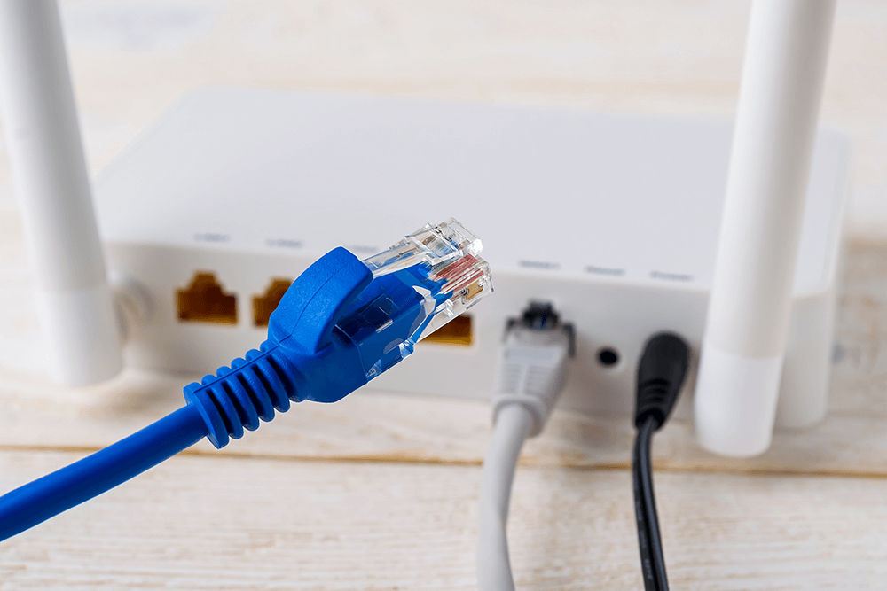

# Networking Basics - Módulo 15   

### Cisco: <a href="../../../">cisco   </a>
### Cisco Networking Academy: cna   </a>
### Training Category: <a href="../../../self_paced/">self-paced</a>
### Software/Subject: network   </a>
### Course: <a href="../">sfp_007 (Networking Basics)   </a>
### Module: 15. TCP e UDP

---

### Theme:
- Network

### Used Tools:
- Operating System (OS): 
  - Windows 11 
- Cloud Services:
  - Google Drive 
- Language:
  - HTML   
  - Markdown   
- Integrated Development Environment (IDE) and Text Editor:
  - Visual Studio Code (VS Code)   
- Versioning: 
  - Git   
- Repository:
  - GitHub   

---

### Course Module 15 Structure:
15. <a name="item15">TCP e UDP</a> 
  15.1 <a href="#item15.01">Introdução</a> 
  15.2 TCP e UDP 
  15.3 <a href="#item15.03">Números de porta</a> 
  15.4 <a href="#item15.04">Resumo da TCP e UDP</a> 

---

### Objective:
O objetivo do módulo é apresentado na introdução, que compõe o primeiro item do desenvolvimento.

### Folder Structure:
- [README.md](./README.md): Este documento de README, escrito em **Markdown**, descrevendo todo conteúdo realizado neste módulo.
- [0-aux](../0-aux/): Pasta auxiliar com imagens utilizadas na construção dos arquivos de README desse curso.

### Development:

<a name="item15.01"><h4>15.1 Introdução</h4></a>[Back to summary](#item15)

📑 Camada de Transporte: Protocolos TCP e UDP   
A transmissão de dados em uma rede é gerenciada por protocolos da camada de transporte que determinam a forma como as informações são segmentadas e entregues. Dependendo da aplicação, a rede pode priorizar a integridade total dos dados ou a velocidade de entrega em tempo real. A distinção técnica entre esses métodos define a estabilidade de serviços críticos, como transferências de arquivos e comunicações multimídia, garantindo que cada fluxo de dados receba o tratamento adequado às suas exigências de latência e confiabilidade.

🎯 Objetivo do módulo:   
- Explicar os mecanismos técnicos de acesso aos serviços de internet através dos protocolos de transporte.

📘 Tópicos do módulo:   
- TCP e UDP: Análise comparativa entre o protocolo de controle de transmissão orientado à conexão e o protocolo de datagrama de usuário baseado no melhor esforço.
- Números de porta: Descrição técnica da utilização de portas lógicas para o direcionamento de dados às aplicações e serviços específicos nos dispositivos finais.

<a name="item15.03"><h4>15.3 Números de porta</h4></a>[Back to summary](#item15)

🌐 Identificação de Serviços e o Papel das Portas   
O cotidiano digital envolve o acesso constante a diversos serviços como DNS, Web, E-mail e VoIP. Esses sistemas operam sob o modelo cliente/servidor e podem estar hospedados em servidores individuais ou em grandes infraestruturas de datacenters. Para que as mensagens sejam entregues corretamente via TCP ou UDP, utilizam-se identificadores numéricos chamados portas. Cada segmento de dados contém uma porta de origem e uma de destino, permitindo o rastreamento de conversas específicas entre os dispositivos.

Ao receber uma solicitação, o servidor determina o serviço desejado com base na porta de destino. Os aplicativos cliente são configurados previamente para utilizar portas padronizadas pela internet. Um exemplo clássico são os navegadores web, que direcionam pedidos para a porta 80 ao utilizarem o protocolo HTTP.

🏛️ Classificação e Gerenciamento (ICANN)   
A ICANN gerencia o intervalo total de portas, que se estende de 1 a 65.535, dividindo-as em três categorias principais:
- Portas Bem Conhecidas (1 a 1.023): Reservadas para serviços universais e aplicações de rede comuns.
- Portas Registradas (1.024 a 49.151): Utilizadas por empresas para registrar aplicações específicas, como softwares de mensagens.
- Portas Privadas ou Dinâmicas (49.152 a 65.535): Empregadas geralmente como portas de origem pelos hosts para iniciar comunicações.

📜 Principais Serviços e Protocolos   
Abaixo, listam-se algumas das portas mais frequentes na administração de redes:
- 20 e 21 (TCP): FTP (Transferência de arquivos - Dados e Controle).
- 22 (TCP): SSH (Acesso remoto seguro).
- 23 (TCP): Telnet (Acesso remoto não criptografado).
- 25 (TCP): SMTP (Envio de e-mail).
- 53 (UDP/TCP): DNS (Resolução de nomes).
- 67 e 68 (UDP): DHCP (Servidor e Cliente para atribuição de IPs).
- 80 (TCP): HTTP (Acesso web padrão).
- 110 (TCP): POP3 (Recebimento de e-mail).
- 143 (TCP): IMAP (Gerenciamento de e-mail no servidor).
- 443 (TCP): HTTPS (Acesso web criptografado).

Nota-se que protocolos como o DNS podem alternar entre UDP (para requisições de clientes) e TCP (para trocas entre servidores), conforme a necessidade de confiabilidade ou velocidade.

🔌 O Conceito de Socket   
A junção de um endereço IP com um número de porta resulta em um socket. Essa combinação identifica de forma única um processo específico em execução no dispositivo. A comunicação é estabelecida através de um "par de sockets", composto pelo socket de origem (IP do cliente + porta dinâmica) e o socket de destino (IP do servidor + porta do serviço).

Essa estrutura permite que um único computador mantenha múltiplas conexões simultâneas sem confusão de dados. Por exemplo, um PC pode abrir uma página web (porta 80) e realizar um download via FTP (porta 21) ao mesmo tempo; os diferentes números de portas de origem garantem que as respostas retornem para as aplicações corretas.

🛡️ Monitoramento com Netstat   
A existência de conexões TCP desconhecidas pode representar riscos à segurança, sugerindo a presença de acessos não autorizados. Para inspecionar o estado atual das comunicações, utiliza-se o utilitário netstat.

Este comando lista os protocolos ativos, endereços locais, endereços externos e o estado de cada conexão. A aplicação da opção -n permite a visualização direta dos endereços IP e números de portas em formato numérico, facilitando a análise técnica ao evitar a resolução automática de nomes de domínio ou serviços.

<a name="item15.04"><h4>15.4 Resumo da TCP e UDP</h4></a>[Back to summary](#item15)

⚡ Protocolo de Entrega UDP   
O UDP opera sob o conceito de melhor esforço, priorizando a velocidade em vez da garantia de entrega. Como não exige confirmações de recebimento, ele é a escolha ideal para transmissões em tempo real, como videochamadas e jogos online, onde um pequeno atraso causado por retransmissões seria mais prejudicial do que a perda ocasional de alguns pacotes de dados.

🛠️ Confiabilidade com TCP   
Diferente do UDP, o TCP foca na integridade da mensagem, dividindo-a em segmentos numerados. O protocolo monitora cada pedaço enviado e, caso não receba uma confirmação de que o dado chegou, realiza a retransmissão apenas da parte perdida. Esse controle garante que as informações cheguem completas e na ordem correta ao destinatário, sendo essencial para navegação web e transferência de arquivos.

🔢 Identificação por Portas   
Para que um computador consiga gerenciar várias conversas simultâneas, ele utiliza números de portas como identificadores em cada segmento de dados. Essas portas funcionam como ramais em um sistema telefônico, permitindo que o sistema operacional direcione cada pacote para o aplicativo ou serviço correto, rastreando quem iniciou a comunicação e para onde ela deve retornar.

🏛️ Gerenciamento e Categorias de Portas   
A organização ICANN é responsável por organizar as portas em três grupos distintos, totalizando mais de 65 mil opções. Existem as portas bem conhecidas (1 a 1023) para serviços universais, as portas registradas (até 49151) para aplicações específicas de empresas e as portas privadas ou dinâmicas, que são usadas temporariamente pelos dispositivos para abrir novas conexões.

🔄 Comunicações Simultâneas   
O número da porta de origem é criado de forma aleatória pelo dispositivo do usuário para cada nova tarefa, como abrir uma aba diferente no navegador. Isso permite que um único computador mantenha múltiplas conexões com o mesmo servidor web ao mesmo tempo, pois cada sessão terá uma porta de origem exclusiva, evitando que as respostas do servidor se misturem.

🌐 Serviços e Portas de Destino   
Ao solicitar um acesso, o cliente já conhece a porta de destino padrão do serviço desejado, como a porta 80 para sites ou a 21 para arquivos. Isso permite que um único servidor ofereça diversos serviços de uma só vez, identificando o que o usuário quer apenas observando o número da porta indicado no pacote de entrada.

🔍 Monitoramento com Netstat   
Conexões ativas de origem desconhecida podem indicar vulnerabilidades ou invasões no sistema. Para auditar o que está acontecendo na rede local, utiliza-se o comando netstat, uma ferramenta que lista todos os protocolos em uso, endereços IPs e portas envolvidas, permitindo visualizar o estado atual de cada conexão estabelecida pelo computador.