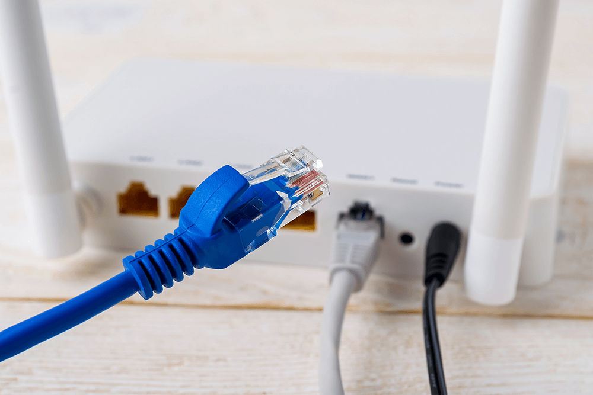

# Networking Basics - Módulo 16   

### Cisco: <a href="../../../">cisco   </a>
### Cisco Networking Academy: cna   </a>
### Training Category: <a href="../../../self_paced/">self-paced</a>
### Software/Subject: network   </a>
### Course: <a href="../">ild_003 (Networking Basics)   </a>
### Module: 16. Serviços da Camada de Aplicação

---

### Theme:
- Network

### Used Tools:
- Operating System (OS): 
  - Windows 11 
- Cloud Services:
  - Google Drive 
- Language:
  - HTML   
  - Markdown   
- Integrated Development Environment (IDE) and Text Editor:
  - Visual Studio Code (VS Code)   
- Versioning: 
  - Git   
- Repository:
  - GitHub   

---

### Course Module 16 Structure:
16. <a name="item16">Serviços da Camada de Aplicação</a> 
  16.1 <a href="#item16.01">Introdução</a> 
  16.2 <a href="#item16.02">A relação Cliente - Servidor</a> 
&nbsp;&nbsp;&nbsp;&nbsp;16.2.1 <a href="../../../pkt/files/pkt_063/">Packet Tracer - A interação do cliente</a> 
  16.3 <a href="#item16.03">Serviços de Aplicação de Rede</a> 
  16.4 <a href="#item16.04">Domain Name System (Sistema de Nomes de Domínios) 
  16.5 <a href="#item16.05">Clientes e servidores Web</a> 
&nbsp;&nbsp;&nbsp;&nbsp;16.5.1 <a href="../../../pkt/files/pkt_064/">Packet Tracer - Observar solicitações Web</a> 
  16.6 <a href="#item16.06">Clientes e servidores FTP</a> 
&nbsp;&nbsp;&nbsp;&nbsp;16.6.1 <a href="../../../pkt/files/pkt_065/">Packet Tracer - Usando serviços FTP</a> 
  16.7 <a href="#item16.07">Terminais virtuais</a> 
&nbsp;&nbsp;&nbsp;&nbsp;16.7.1 <a href="../../../pkt/files/pkt_066/">Packet Tracer - Uso do Telnet e SSH</a> 
  16.8 <a href="#item16.08">E-mail e mensagens</a> 
  16.9 <a href="#item16.09">Resumo dos serviços da camada de aplicação</a> 

---

### Objective:
O objetivo do módulo é apresentado na introdução, que compõe o primeiro item do desenvolvimento.

### Folder Structure:
- [README.md](./README.md): Este documento de README, escrito em **Markdown**, descrevendo todo conteúdo realizado neste módulo.
- [0-aux](../0-aux/): Pasta auxiliar com imagens utilizadas na construção dos arquivos de README desse curso.

### Development:

<a name="item16.01"><h4>16.1 Introdução</h4></a>[Back to summary](#item16)

🌐 Serviços e Protocolos da Camada de Aplicação   
A camada de aplicação representa a interface direta entre o software utilizado pelo usuário e a infraestrutura de rede subjacente. É neste nível que as requisições de dados são processadas por meio de protocolos específicos, permitindo que serviços como navegação web, transferência de arquivos e troca de mensagens eletrônicas operem de forma padronizada. O funcionamento desses serviços depende da coordenação técnica entre as solicitações originadas em terminais locais e as respostas fornecidas por sistemas remotos distribuídos na rede.

🎯 Objetivo do módulo:   
- Explicar a funcionalidade e a operação dos serviços fundamentais que compõem a camada de aplicação.

📘 Tópicos do módulo:   
- A relação Cliente-Servidor: Análise da dinâmica de interação entre dispositivos que requisitam dados e sistemas que processam e fornecem recursos.
- Serviços de Aplicação de Redes: Descrição geral das aplicações que viabilizam a comunicação e o acesso a dados em ambientes de rede.
- Domain Name System (DNS): Estudo do sistema responsável pela resolução de nomes de domínio em endereçamentos IP.
- Clientes e servidores Web: Detalhamento do protocolo HTTP e da linguagem de marcação HTML na estruturação da rede mundial.
- Clientes e servidores FTP: Descrição dos mecanismos de transferência de arquivos entre sistemas computacionais.
- Terminais virtuais: Explicação sobre os protocolos de acesso remoto Telnet e SSH para gestão de dispositivos.
- E-mails e mensagens: Especificação dos protocolos envolvidos no envio e recebimento de correio eletrônico e mensagens instantâneas.

<a name="item16.02"><h4>16.2 A relação Cliente - Servidor</h4></a>[Back to summary](#item16)

🌐 O Ecossistema Cliente/Servidor e a Infraestrutura Digital   
A rotina moderna é pautada por interações constantes com serviços de rede e internet, muitas vezes sem a percepção da complexidade técnica envolvida. Transações comerciais, atualizações em redes sociais e o recebimento de mensagens eletrônicas dependem de uma arquitetura sofisticada que interconecta diversos dispositivos de rede através de padrões e protocolos universais.

Nesse cenário, as funções dividem-se em dois papéis fundamentais:
- Servidor: Trata-se de um host que executa aplicações específicas para disponibilizar informações ou recursos aos demais dispositivos da rede. Milhões de servidores operam globalmente, suportando desde downloads de mídia até operações financeiras críticas.
- Cliente: Refere-se ao software utilizado para solicitar e acessar os serviços oferecidos. Um único equipamento pode executar múltiplos softwares clientes simultaneamente, permitindo que o usuário navegue na web, ouça streaming e verifique correios eletrônicos de forma concorrente.

🖥️ Aplicações Comuns de Servidores   
A especialização dos servidores garante a eficiência na distribuição de serviços. Entre os modelos mais frequentes, destacam-se:
- Serviços de E-mail: O servidor armazena e gerencia as mensagens, enquanto o cliente (como o Microsoft Outlook) realiza o acesso e a organização dos dados.
- Serviços Web: O software de servidor hospeda os sites e páginas, que são interpretados por navegadores como Chrome ou Firefox no lado do cliente.
- Serviços de Arquivos: Proporcionam um local centralizado para o armazenamento de documentos corporativos ou pessoais, acessados via gerenciadores de arquivos (como o Explorador de Arquivos do Windows).

🔗 Identificação de Recursos: URI, URN e URL   
Os recursos e APIs disponíveis na rede são localizados por meio de um Identificador de Recurso Uniforme (URI). Trata-se de uma cadeia de caracteres estruturada que aponta para um recurso específico, dividindo-se em duas categorias:
- URN (Nome de Recurso Uniforme): Define o nome ou espaço de nome do recurso (como uma imagem ou documento) de forma persistente, sem especificar o protocolo de acesso.
- URL (Localizador de Recurso Uniforme): Além de identificar o recurso, especifica sua localização na rede e o protocolo necessário para o acesso (como HTTP, HTTPS, FTP ou SFTP).

🛠️ Estrutura Técnica de uma URI:   
A composição de uma URI segue uma ordem lógica para garantir a precisão do acesso:
- Protocolo/Esquema: Indica o método de comunicação (ex: https, sftp, mailto).
- Nome do Host: Identifica o endereço do servidor onde o recurso reside (ex: www.exemplo.com).
- Caminho e Nome do Arquivo: Especifica a localização exata dentro da estrutura de pastas do servidor (ex: /diretorio/documento.html).
- Fragmento: Aponta para uma seção específica dentro do arquivo (ex: #pagina155).

<a name="item16.03"><h4>16.3 Serviços de Aplicação de Rede</h4></a>[Back to summary](#item16)

🌐 A Infraestrutura por Trás da Navegação Diária   
O cotidiano digital é sustentado por uma série de interações invisíveis entre dispositivos. Atividades habituais — como realizar buscas, interagir em redes sociais, consumir mídia via streaming ou efetuar compras em plataformas de e-commerce — dependem diretamente da pilha de protocolos TCP/IP. Esse conjunto de normas garante que a troca de informações entre clientes e servidores ocorra de maneira íntegra e confiável em toda a rede mundial.

🛠️ Protocolos de Infraestrutura e Gerenciamento   
Para que a internet funcione de forma organizada e automatizada, existem protocolos específicos que gerenciam a identificação e o acesso aos dispositivos:
- DNS (Domain Name System): Atua como o tradutor da rede, convertendo nomes de domínios legíveis por humanos (como endereços de sites) nos respectivos endereços IP que os computadores utilizam para se localizar.
- SSH (Secure Shell): Proporciona um canal seguro e criptografado para o gerenciamento remoto de servidores e ativos de rede, garantindo que a administração da infraestrutura ocorra de forma protegida contra interceptações.
- DHCP (Dynamic Host Configuration Protocol): Responsável pela automação do endereçamento. Este serviço atribui dinamicamente endereços IP e demais parâmetros de rede aos dispositivos, permitindo a conectividade imediata sem a necessidade de intervenção manual.

📩 Comunicação e Transferência de Dados   
A troca de mensagens e arquivos possui regras bem definidas para assegurar que o conteúdo chegue ao destino e possa ser recuperado corretamente:
- O Ecossistema de E-mail (SMTP, POP e IMAP):
  - O SMTP é o motor de envio, transportando as mensagens do cliente para o servidor e entre servidores de correio.
  - Já o POP e o IMAP são focados na recepção; enquanto o primeiro costuma baixar as mensagens para o dispositivo local, o segundo permite a gestão e sincronização dos e-mails diretamente no servidor remoto.
- HTTP (Hypertext Transfer Protocol): É a base da World Wide Web. Navegadores utilizam este protocolo para solicitar conteúdos, enquanto os servidores web o empregam para transferir os arquivos (textos, imagens e scripts) que compõem as páginas acessadas.
- FTP (File Transfer Protocol): Um protocolo dedicado especificamente à movimentação de arquivos entre sistemas, permitindo o upload e download de dados de forma interativa e estruturada.

A harmonia entre esses serviços e o modelo cliente-servidor é o que permite a estabilidade e a expansão contínua da internet moderna.

<a name="item16.04"><h4>16.4 Domain Name System (Sistema de Nomes de Domínios)</h4></a>[Back to summary](#item16)

🔍 Configuração e Funcionamento do Sistema de Nomes (DNS)   
O DNS é um componente vital na conectividade de rede, atuando como o serviço de tradução da internet. Ao realizar o ajuste manual dos parâmetros de rede em um dispositivo, torna-se indispensável o preenchimento do campo referente ao servidor DNS para viabilizar a navegação por nomes de domínio em vez de apenas endereços numéricos.

🏠 Automatização em Redes Locais   
Em infraestruturas residenciais, a gestão desses endereços ocorre predominantemente de forma dinâmica por meio do protocolo DHCP. O processo segue uma hierarquia lógica:
- O Provedor de Serviços de Internet (ISP) encaminha os endereços dos servidores DNS ao roteador doméstico.
- O roteador, operando como servidor DHCP, distribui essa configuração automaticamente para todos os equipamentos conectados à rede local.
- Essa automação elimina a necessidade de intervenção manual em smartphones, laptops e outros dispositivos terminais.

⚙️ O Fluxo da Resolução de Nomes   
O processo de resolução ocorre de forma obrigatória antes do estabelecimento de qualquer conexão web. A sequência de eventos para o acesso a um recurso segue esta ordem:
- Solicitação de Nome: Ao inserir um endereço como www.cisco.com no navegador, o cliente DNS interno do dispositivo consulta o servidor DNS configurado.
- Tradução para IP: O servidor responde com o endereço IPv4 correspondente ao nome solicitado (como o 172.230.155.162).
- Estabelecimento da Conexão: Somente após o recebimento dessa identificação numérica, o dispositivo torna-se capaz de disparar a requisição HTTP para o servidor de destino, iniciando o carregamento da página.

<a name="item16.05"><h4>16.5 Clientes e servidores Web</h4></a>[Back to summary](#item16)

🌐 A Dinâmica da Comunicação na World Wide Web   
O acesso a conteúdos na internet ocorre por meio de uma interação coordenada entre navegadores e servidores. Assim que o endereço IP do destino é identificado, o navegador inicia uma solicitação de serviço utilizando o protocolo HTTP (Hypertext Transfer Protocol). Por padrão, essa comunicação é direcionada à porta 80 do servidor, estabelecendo o canal necessário para a transferência dos dados que compõem o site desejado.

🎨 Codificação e Apresentação com HTML   
A exibição visual de uma página web não depende apenas da transferência de dados, mas de como as informações são interpretadas. O conteúdo é estruturado através de linguagens de marcação, sendo o HTML (HyperText Markup Language) a mais difundida. Esta linguagem fornece as instruções precisas ao navegador sobre a formatação do texto, a disposição de elementos gráficos e a seleção de fontes, garantindo que o usuário visualize a interface conforme o planejamento original.

🛡️ Segurança: A Evolução para o HTTPS   
A arquitetura original do protocolo HTTP possui limitações críticas de segurança, uma vez que os dados trafegam sem criptografia, facilitando a interceptação por terceiros. Para mitigar esse risco e proteger informações sensíveis, utiliza-se a versão segura do protocolo, o HTTPS.

As principais distinções operacionais incluem:
- Porta de Comunicação: Enquanto o tráfego padrão utiliza a porta 80, o HTTPS opera na porta 443.
- Criptografia: O uso de protocolos de transporte seguros garante a integridade e a confidencialidade das mensagens.
- Identificação: A utilização deste protocolo é sinalizada pelo prefixo https:// na barra de endereços do navegador.

🤝 Padronização e Interoperabilidade   
A existência de uma vasta diversidade de softwares, tanto do lado do servidor quanto do cliente, exige um consenso técnico para o funcionamento global da rede. A adoção de padrões universais para o HTML e o protocolo HTTP assegura que navegadores de diferentes fabricantes consigam processar e exibir conteúdos hospedados em qualquer tipo de servidor web. Essa interoperabilidade é o pilar que sustenta o crescimento e a acessibilidade da rede mundial de computadores.

<a name="item16.06"><h4>16.6 Clientes e servidores FTP</h4></a>[Back to summary](#item16)

📂 O Protocolo de Transferência de Arquivos (FTP)   
Além da navegação web, a movimentação de arquivos entre sistemas distintos representa um dos serviços mais fundamentais da internet. O FTP (File Transfer Protocol) estabelece um método eficiente para a troca de dados entre computadores, operando sob o modelo cliente-servidor. Por meio de softwares específicos, torna-se possível realizar o gerenciamento remoto de arquivos, abrangendo desde a transferência de documentos até a organização de diretórios.

⚙️ Arquitetura de Conexão Dupla   
O diferencial operacional do serviço FTP reside na utilização de dois canais de comunicação independentes para garantir a eficiência e o controle das tarefas:
- Porta TCP 21 (Conexão de Controle): Destinada exclusivamente ao envio de comandos e recepção de respostas. É por meio desta porta que o cliente solicita ações como autenticação, exclusão ou renomeação de arquivos.
- Porta TCP 20 (Conexão de Dados): Ativada apenas no momento da transferência propriamente dita. Esta porta dedica-se integralmente ao fluxo de bits do arquivo, seja em processos de upload ou download.

🖥️ Ferramentas e Interfaces de Acesso   
O acesso a servidores FTP pode ser realizado de diversas formas, adaptando-se à necessidade do administrador ou do usuário comum:
- Sistemas Operacionais: Muitos terminais de comando possuem clientes FTP nativos.
- Navegadores Web: Suportam o acesso básico para visualização e download de arquivos através da URL.
- Clientes Independentes (GUI): Aplicativos dedicados que oferecem interfaces gráficas intuitivas, facilitando o gerenciamento de grandes volumes de dados e permissões.

🔄 O Fluxo de Trabalho do FTP   
A operação técnica do protocolo segue uma sequência lógica dividida em três etapas principais:
- Estabelecimento do Controle: O cliente inicia o contato com o servidor através da porta 21. Este canal permanece aberto durante toda a sessão para gerenciar o tráfego e as instruções.
- Abertura do Canal de Dados: Quando uma transferência é solicitada, uma segunda conexão é estabelecida para tratar especificamente o conteúdo do arquivo.
- Execução da Transferência: O servidor movimenta os dados para o cliente (download) ou recebe as informações enviadas por ele (upload). A direção do fluxo é determinada estritamente pelos comandos enviados previamente pelo canal de controle.

Essa separação entre controle e dados permite que o gerenciamento do servidor ocorra de forma fluida, sem que o envio de comandos sofra interferências durante a transferência de arquivos extensos.

<a name="item16.07"><h4>16.7 Terminais virtuais</h4></a>[Back to summary](#item16)

🖥️ A Evolução do Acesso Remoto: Do Terminal Físico ao Virtual   
Historicamente, o controle de sistemas computacionais era realizado por meio de terminais físicos diretamente conectados a um computador central ou mainframe. Com a expansão das redes de dados, surgiu a necessidade de replicar essa capacidade de gerenciamento à distância. Para suprir essa demanda, desenvolveu-se a capacidade de emular esses dispositivos através do software, permitindo que a administração de sistemas ocorresse sem a necessidade de presença física no local do hardware.

📠 O Protocolo Telnet e as Sessões VTY   
Criado no início da década de 1970, o Telnet consolidou-se como um dos serviços de camada de aplicação mais antigos da pilha TCP/IP. Sua função primordial é a emulação de terminais baseados em texto, operando na porta TCP 23. O funcionamento técnico baseia-se na criação de uma Linha de Terminal Virtual (VTY). Em vez de um cabo físico, o software estabelece uma conexão lógica que fornece acesso integral à Interface de Linha de Comando (CLI) do servidor. Uma vez estabelecida a sessão, o administrador pode executar tarefas de alta criticidade, como:
- Configuração de parâmetros de rede e segurança.
- Inicialização ou interrupção de processos e serviços.
- Gerenciamento de arquivos e desligamento remoto do sistema.

⚠️ A Vulnerabilidade do Texto Plano   
Apesar de sua funcionalidade histórica e simplicidade de configuração, o Telnet apresenta uma falha estrutural grave para os padrões modernos: a ausência de criptografia. Toda a troca de informações — incluindo nomes de usuário e senhas — trafega pela rede em formato de texto simples. Essa característica torna as sessões Telnet extremamente vulneráveis a ataques de interceptação (sniffing). Qualquer agente mal-intencionado com acesso ao fluxo de dados pode capturar e ler integralmente o conteúdo da comunicação, comprometendo a integridade de todo o sistema.

🛡️ SSH: O Padrão de Segurança para Gerenciamento   
Como alternativa robusta e segura, o protocolo SSH (Secure Shell) tornou-se o padrão obrigatório para profissionais de infraestrutura. Ele oferece uma estrutura de proteção superior para o login remoto e outros serviços de rede.

As principais vantagens do SSH em relação ao Telnet incluem:
- Criptografia de Dados: Todo o tráfego da sessão é codificado, tornando os dados ilegíveis para interceptadores.
- Autenticação Forte: Utilização de métodos mais rigorosos para validar a identidade das partes envolvidas na conexão.
- Integridade da Comunicação: Garantia de que as informações não foram alteradas durante o percurso entre o cliente e o servidor.

Em qualquer ambiente de produção, a substituição do Telnet pelo SSH é considerada uma das melhores práticas de segurança fundamentais para a proteção de ativos críticos de rede.

<a name="item16.08"><h4>16.8 E-mail e mensagens</h4></a>[Back to summary](#item16)

📩 Arquitetura do Correio Eletrônico   
O funcionamento do e-mail baseia-se em um ciclo de armazenamento e encaminhamento entre servidores. A estrutura central é a caixa de correio eletrônica, vinculada a um domínio específico. O acesso a esse serviço ocorre por meio de protocolos que ditam como a mensagem sai da origem e como chega ao destinatário final.
- Fluxo de Saída (SMTP): Atua como o transportador das mensagens. Este protocolo entra em ação quando o cliente envia o conteúdo para o servidor local ou quando servidores trocam mensagens entre si. A operação padrão ocorre na porta 25.
- Gestão de Recebimento (POP3 vs. IMAP):
  - No POP3 (porta 110), o foco é o descarregamento: as mensagens são transferidas para o dispositivo e, geralmente, apagadas da nuvem.
  - No IMAP (porta 143), prioriza-se a onipresença: o conteúdo permanece no servidor, permitindo que múltiplos dispositivos visualizem a mesma caixa de entrada de forma sincronizada.

💬 Interação em Tempo Real e Mensageria   
A comunicação instantânea evoluiu de simples janelas de texto para plataformas robustas de colaboração. Independentemente do nome utilizado — chat, mensagem direta ou private message — a premissa é a troca de informações em tempo real através da rede. Atualmente, o mercado divide-se entre soluções integradas a redes sociais e softwares corporativos dedicados (como Microsoft Teams ou WhatsApp). Além da agilidade na conversação, essas ferramentas suportam a transmissão de diversos formatos de mídia, transformando-se em canais multifuncionais para o compartilhamento de arquivos e documentos.

📞 Tecnologia VoIP e Voz sobre Dados   
A telefonia moderna utiliza a infraestrutura da internet para transportar áudio, eliminando a dependência exclusiva de circuitos analógicos. Esse processo é viabilizado pelo VoIP, que realiza a conversão de ondas sonoras em pacotes de dados digitais.

Pontos fundamentais da Telefonia IP:
- Digitalização: O sinal de voz é transformado em bits e encapsulado em pacotes IP para trafegar na rede.
- Identificação Lógica: O uso de nomes de usuários ou identificadores digitais substitui os números de telefone físicos tradicionais dentro da rede.
- Interoperabilidade (Gateways): Para que uma chamada de internet alcance um telefone fixo ou celular comum, utiliza-se um gateway que faz a ponte com a rede telefônica pública (PSTN).

Essa transição para o ambiente digital permite que o tráfego de voz seja gerenciado com a mesma lógica de qualquer outro dado na rede, embora exija protocolos específicos para garantir que a conversa não sofra atrasos ou falhas de sincronia.

<a name="item16.09"><h4>16.9 Resumo dos serviços da camada de aplicação</h4></a>[Back to summary](#item16)

🖥️ O Modelo Cliente/Servidor   
Um servidor é um sistema robusto que executa softwares específicos para oferecer recursos ou dados a outros dispositivos na rede. O cliente, como um navegador web, inicia a comunicação enviando uma solicitação ao servidor, que então processa o pedido e devolve o serviço desejado. Essa interação só é possível porque ambos seguem padrões globais de comunicação que garantem que falem a mesma "língua".

🔗 Identificadores URI, URL e URN   
Para localizar qualquer recurso na rede, utilizamos o URI, um identificador genérico que possui partes como o protocolo e o caminho do arquivo. Ele se divide em duas especializações: a URL, que indica o endereço exato de onde o recurso está hospedado (como links HTTP), e a URN, que apenas nomeia o recurso de forma persistente, sem depender de sua localização física ou protocolo de acesso.

🌐 Serviço de Nomes DNS   
O DNS funciona como a lista telefônica da internet, traduzindo nomes de domínios amigáveis (como .com ou .org) em endereços IP numéricos que as máquinas entendem. Quando o usuário digita um site, o computador consulta um servidor DNS; se este não souber o endereço, ele pergunta a outros servidores na hierarquia até encontrar a resposta e enviá-la de volta para o dispositivo.

🔒 Protocolos Web HTTP e HTTPS   
O HTTP é o protocolo base para a navegação, utilizando a porta 80 para transferir páginas formatadas em HTML, que ditam o visual do site. Como o HTTP trafega dados em texto puro e é vulnerável a interceptações, utiliza-se o HTTPS na porta 443. O HTTPS adiciona uma camada de criptografia para proteger informações sensíveis durante o trajeto entre o navegador e o servidor.

📁 Transferência de Arquivos via FTP   
O FTP é uma ferramenta dedicada ao envio e recebimento de arquivos entre computadores. Ele se diferencia por utilizar duas conexões simultâneas: a porta 21 para o envio de comandos e controle da sessão, e a porta 20 para o tráfego real dos dados. Esse serviço pode ser acessado tanto por linhas de comando quanto por interfaces gráficas que facilitam a gestão remota de arquivos.

💻 Acesso Remoto via Telnet e SSH   
O Telnet permite controlar um dispositivo à distância através de um terminal virtual, mas é considerado inseguro por enviar todas as informações, inclusive senhas, sem proteção pela rede. Por esse motivo, o SSH tornou-se o padrão profissional, pois oferece as mesmas funcionalidades de acesso remoto, porém com autenticação forte e criptografia de todos os dados da sessão.

📧 Funcionamento do E-mail (SMTP, POP e IMAP)   
O sistema de correio eletrônico depende de três protocolos distintos: o SMTP é utilizado para o envio de mensagens do cliente para o servidor ou entre servidores (porta 25). Para o recebimento, o POP3 (porta 110) baixa as mensagens para o computador e costuma apagá-las do servidor, enquanto o IMAP (porta 143) mantém os e-mails sincronizados no servidor, permitindo o acesso de vários dispositivos.

🎙️ Comunicação em Tempo Real e VoIP   
As mensagens instantâneas e a telefonia via internet permitem a interação humana imediata através da rede. No caso do VoIP, a voz analógica é transformada em pacotes digitais e enviada via protocolo IP. Diferente de outros serviços centralizados, muitas dessas tecnologias utilizam arquiteturas ponto a ponto (P2P) para conectar os usuários de forma direta e eficiente.