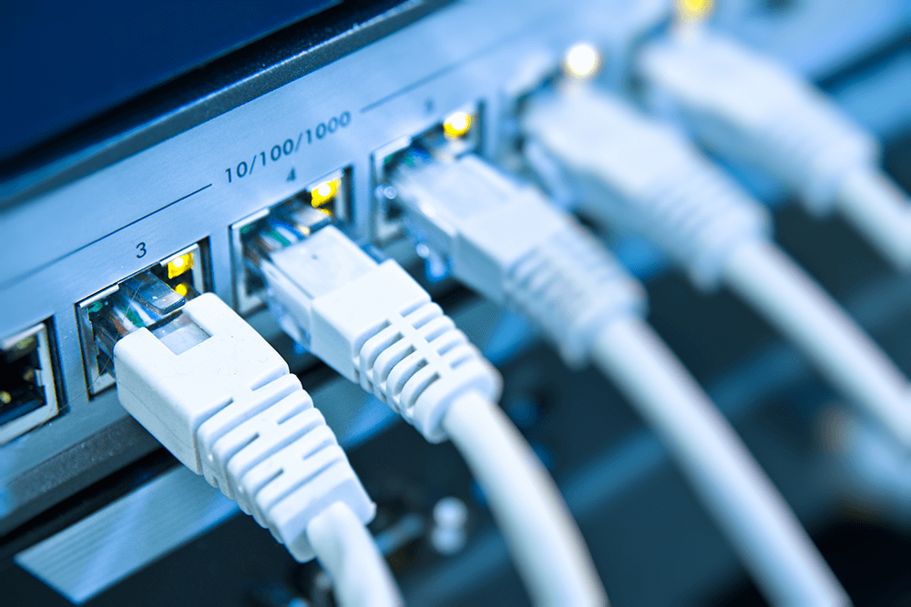

# Networking Devices and Initial Configuration - Módulo 11   

### Cisco: <a href="../../../">cisco   </a>
### Cisco Networking Academy: cna   </a>
### Training Category: <a href="../../../self_paced/">self-paced</a>
### Software/Subject: network   </a>
### Course: <a href="../">sfp_008 (Networking Devices and Initial Configuration)   </a>
### Module: 11. Criar uma rede pequena da Cisco

---

### Theme:
- Network

### Used Tools:
- Operating System (OS): 
  - Windows 11 
- Cloud Services:
  - Google Drive 
- Language:
  - HTML   
  - Markdown   
- Integrated Development Environment (IDE) and Text Editor:
  - Visual Studio Code (VS Code)   
- Versioning: 
  - Git   
- Repository:
  - GitHub   

---

### Course Module 11 Structure:
11. <a name="item11">Criar uma rede pequena da Cisco</a> 
  11.1 <a href="#item11.01">Introdução</a> 
  11.2 <a href="#item11.02">Configuração Básica de Switch</a> 
&nbsp;&nbsp;&nbsp;&nbsp;11.2.1 <a href="../../../pkt/files/pkt_008/">Packet Tracer - Implementação da conectividade básica</a> 
  11.3 <a href="#item11.03">Configurar definições iniciais do roteador</a> 
&nbsp;&nbsp;&nbsp;&nbsp;11.3.1 <a href="../../../pkt/files/pkt_026/">Packet Tracer – Definição das Configurações Iniciais de um Roteador</a> 
  11.4 <a href="#item11.04">Proteção dos Dispositivos</a> 
&nbsp;&nbsp;&nbsp;&nbsp;11.4.1 <a href="../../../pkt/files/pkt_070/">Packet Tracer - Configuração do SSH</a> 
  11.5 <a href="#item11.05">Configurar o gateway padrão</a> 
&nbsp;&nbsp;&nbsp;&nbsp;11.5.1 <a href="../../../pkt/files/pkt_030/">Packet Tracer - Construir uma rede de switch e roteador - Modo Físico</a> 
&nbsp;&nbsp;&nbsp;&nbsp;11.5.2 <a href="../../../pkt/files/pkt_029/">Packet Tracer - Solucionar problemas de gateway padrão</a> 
  11.6 <a href="#item11.06">Resumo de Construindo uma Rede Cisco Pequena</a> 

---

### Objective:
O objetivo do módulo é apresentado na introdução, que compõe o primeiro item do desenvolvimento.

### Folder Structure:
- [README.md](./README.md): Este documento de README, escrito em **Markdown**, descrevendo todo conteúdo realizado neste módulo.
- [0-aux](../0-aux/): Pasta auxiliar com imagens utilizadas na construção dos arquivos de README desse curso.

### Development:

<a name="item11.01"><h4>11.1 Introdução</h4></a>[Back to summary](#item11)

🏢 Implementação e Configuração de Infraestrutura Local Cisco   
A estruturação de redes corporativas interconectadas demanda a inicialização e a parametrização correta dos ativos de rede para viabilizar o tráfego interno e a comunicação com redes externas. Esse processo envolve a aplicação de diretrizes de configuração inicial em switches e roteadores, o estabelecimento de mecanismos de proteção contra acessos não autorizados e a definição de rotas de saída padrão, garantindo que os terminais locais alcancem a internet e os servidores centrais com segurança e estabilidade.

🎯 Objetivo do módulo:   
- Construir uma infraestrutura de rede local funcional utilizando dispositivos e roteamentos baseados no ecossistema Cisco.

📘 Tópicos do módulo:   
- Configuração Básica de Switch: Implementação das diretivas iniciais de gerenciamento, identificação e ativação de interfaces em comutadores de rede.
- Configuração Básica de Roteador: Parametrização fundamental de dispositivos de camada 3, incluindo o endereçamento de interfaces lógicas e físicas.
- Proteção dos Dispositivos: Aplicação de senhas, criptografia e protocolos de acesso para garantir o gerenciamento remoto seguro dos equipamentos.
- Configurar o gateway padrão: Definição do ponto de saída lógico nos hosts e switches para permitir a comunicação além dos limites da rede local.

<a name="item11.02"><h4>11.2 Configuração Básica de Switch</h4></a>[Back to summary](#item11)

🔒 Diretrizes de Configuração Inicial e Segurança em Switches Cisco   
Antes de acoplar um switch de rede local (LAN) ao ambiente de produção, é fundamental aplicar parâmetros básicos de segurança e identificação. A parametrização inicial de um switch envolve a definição de um nome descritivo, a proteção das interfaces de gerenciamento por meio de credenciais de acesso, a criptografia de dados locais e a configuração de conectividade lógica.

📛 Identificação Lógica: O Nome de Host (Hostname)   
Assim como estações de trabalho e servidores possuem nomes exclusivos para identificação na rede, os ativos de infraestrutura exigem uma nomenclatura padronizada. A adoção de um nome de host descritivo facilita a administração, principalmente quando a identificação incorpora dados geográficos ou estruturais sobre o local de instalação do equipamento, como o padrão SW_Bldg_R-Room_216.

🔑 Métodos de Autenticação e Proteção de Acesso   
A segurança de um switch baseia-se no bloqueio dos seus diferentes canais de entrada. É mandatório configurar senhas de proteção para todos os métodos de acesso disponíveis na linha de comando:
- Acesso Local (Console): Protege a porta física de console contra conexões diretas não autorizadas no local onde o hardware está instalado.
- Acesso Remoto (Linhas VTY): Controla as conexões virtuais estabelecidas através da rede. O gerenciamento remoto pode utilizar o protocolo Telnet ou o protocolo SSH. O Telnet trafega credenciais em texto claro e não é considerado seguro; o SSH é o método recomendado por criptografar todo o fluxo de dados, incluindo usuários e senhas.
- Modo Executivo Privilegiado: Exige uma senha robusta para impedir que usuários comuns ganhem privilégios administrativos e realizem alterações estruturais na configuração do sistema.

🗺️ Endereçamento de Gerenciamento e a Interface SVI   
Os switches de Camada 2 não demandam endereços IP para realizar o encaminhamento de quadros Ethernet entre as portas físicas. O provisionamento de parâmetros lógicos de rede serve exclusivamente para habilitar o gerenciamento em banda do dispositivo, permitindo que o administrador acesse a CLI remotamente via SSH, Telnet ou interfaces HTTP.

Os requisitos de rede de um switch espelham as configurações de um computador convencional:
- Interface Virtual de Switch (SVI): Como o switch não possui uma porta IP física nativa, o endereço lógico é vinculado a uma interface virtual interna, sendo a interface vlan 1 o padrão de fábrica. Esta SVI deve receber um endereço IPv4 e uma máscara de sub-rede condizentes com o escopo da rede local.
- Ativação Lógica: Por padrão, as interfaces virtuais do Cisco IOS permanecem desativadas administrativamente. É necessário acionar o comando de inicialização para que a interface passe a responder pelo tráfego.
- Gateway Padrão: Para que o switch possa ser gerenciado a partir de sub-redes remotas ou links externos, ele necessita da rota de saída fornecida pelo roteador local. Esse apontamento é configurado globalmente no sistema por meio do comando de gateway padrão.

📝 Roteiro Sequencial de Comandos para Parametrização   
O cumprimento das metas de segurança e conectividade em um switch Cisco segue uma sequência lógica de comandos executados a partir dos modos de configuração global e de linha:
- Definição do Nome do Ativo: Acessa-se o modo global para aplicar o identificador por meio do comando `hostname [nome]`.
- Proteção do Canal de Console: Entra-se no escopo da linha física via `line console 0`, define-se a credencial com `password [senha]` e ativa-se a checagem com a diretiva `login`.
- Proteção das Linhas Virtuais (Acesso Remoto): Ingressa-se no bloco de terminais virtuais por meio do comando `line vty 0 15` (abrangendo as 16 sessões simultâneas suportadas), aplicando os comandos `password [senha]` e `login`.
- Proteção do Modo Privilegiado: Configura-se uma senha criptografada de alto nível para o modo # utilizando a diretiva global `enable secret [senha]`.
- Ofuscação de Senhas Locais: Por padrão, o arquivo de configuração do IOS armazena as senhas das linhas VTY e Console em texto simples. Para ofuscá-las e impedir a leitura visual do arquivo por terceiros, ativa-se o recurso global `service password-encryption`.
- Inserção de Notificação Legal: Exibe um aviso de advertência jurídica antes do prompt de login para desencorajar acessos maliciosos. Configura-se através do comando `banner motd [delimitador] [mensagem] [delimitador]`, onde o delimitador é um caractere qualquer (como #) usado para abrir e fechar o bloco de texto.
- Configuração Lógica da SVI: Entra-se na subinterface virtual executando `interface vlan 1`. Associa-se o endereço com o comando `ip address [endereço-ip] [máscara-subrede]` e força-se a inicialização da interface com a diretiva `no shutdown`.
- Apontamento do Roteador Local: Em nível global, insere-se o comando `ip default-gateway [endereço-ip-do-roteador]`.
- Persistência das Configurações: Todas as alterações descritas acima são gravadas temporariamente na memória RAM (running-config). Para evitar a perda dos dados em caso de reinicialização ou queda de energia, as informações devem ser copiadas para a memória NVRAM estável utilizando a instrução `copy running-config startup-config`.

<a name="item11.03"><h4>11.3 Configurar definições iniciais do roteador</h4></a>[Back to summary](#item11)

🔒 Protocolo de Configuração Inicial e Hardening em Roteadores Cisco   
O processo de provisionamento inicial de um roteador exige a aplicação de uma sequência estruturada de comandos para garantir a identidade do ativo, o controle de acesso e a persistência dos parâmetros. Diferente dos switches, os roteadores gerenciam as fronteiras entre redes distintas, tornando o endurecimento de suas credenciais um requisito crítico de segurança.

A implementação dessa base operacional divide-se em sete etapas lógicas consecutivas:
- Etapa 1 - Definição da Identidade do Ativo: O nome do dispositivo é aplicado no modo de configuração global através do comando hostname seguido pelo nome desejado (como R1). A alteração desse identificador modifica imediatamente o prompt da interface de linha de comando, facilitando a navegação do administrador e indicando visualmente qual equipamento está sendo editado.
- Etapa 2 - Proteção do Modo Executivo Privilegiado: O modo de execução privilegiada concede controle total sobre os arquivos de sistema e parâmetros do hardware. É imperativo o uso de uma credencial complexa nesta etapa, protegendo o acesso por meio do comando enable secret seguido da senha escolhida, o que ativa um algoritmo de criptografia forte para restringir o acesso à configuração do dispositivo.
- Etapa 3 - Proteção do Acesso Físico Local: Bloqueia tentativas de invasão ou conexões diretas via cabo na porta física de console do roteador. Para isso, entra-se no modo de linha com o comando `line console 0`, define-se a senha com o comando password e ativa-se a checagem no login com o comando `login`.
- Etapa 4 - Proteção e Controle do Acesso Remoto: Os roteadores gerenciam nativamente um número menor de conexões simultâneas padrão em suas linhas virtuais, configuradas geralmente pelo comando line vty 0 4, o que totaliza cinco sessões paralelas. Além de definir uma senha e ativar o login, os roteadores permitem especificar quais protocolos de transporte podem gerenciar o dispositivo através do comando transport input, recomendando-se o uso exclusivo do protocolo SSH para bloquear o tráfego inseguro do Telnet.
- Etapa 5 - Ofuscação Global de Credenciais: Por padrão, as senhas definidas para as linhas de console e terminais virtuais permanecem expostas em texto limpo no arquivo de configuração do sistema operacional. O acionamento do comando global `service password-encryption` garante que todas as senhas legíveis sejam convertidas em hashes de forma global, impedindo a leitura visual do arquivo por terceiros.
- Etapa 6 - Configuração do Banner de Advertência Jurídica: Exibe uma notificação legal explícita antes do prompt de autenticação, advertindo que o equipamento é de acesso restrito e deve ser acessado apenas por usuários autorizados. A mensagem é configurada com o comando banner motd, seguido por um caractere delimitador idêntico no início e no fim do texto de aviso.
- Etapa 7 - Persistência e Gravação dos Parâmetros: Todas as diretivas executadas nos passos anteriores residem temporariamente na memória RAM, correspondendo ao arquivo running-config. Se o roteador sofrer uma queda de energia ou reinicialização acidental antes do salvamento, todos os dados serão perdidos. Para consolidar as alterações na memória não volátil estável (NVRAM), utiliza-se o comando `copy running-config startup-config` a partir do modo executivo privilegiado.

<a name="item11.04"><h4>11.4 Proteção dos Dispositivos</h4></a>[Back to summary](#item11)

🛡️ Diretrizes Estruturais para Criação de Credenciais Robustas   
O estabelecimento de senhas fortes constitui a primeira linha de defesa no endurecimento de ativos de infraestrutura de rede. A criação de credenciais institucionais deve ser pautada por regras de complexidade e entropia para mitigar ataques de força bruta e dicionário.

As boas práticas internacionais estabelecem os seguintes critérios de validação para credenciais:
- Extensão Mínima: A composição deve possuir no mínimo oito caracteres, sendo recomendável o uso de dez ou mais símbolos, visto que o comprimento total eleva exponencialmente o tempo necessário para quebra por força bruta.
- Complexidade de Caracteres: É mandatória a combinação simultânea de letras maiúsculas, letras minúsculas, caracteres numéricos e símbolos especiais.
- Adoção de Erros Propositais: Uma tática eficiente para ludibriar dicionários automatizados de invasão consiste em cometer deslizes ortográficos deliberados em termos conhecidos, como substituir caracteres por homóglifos semelhantes.
- Vedações Absolutas: É proibido o uso de sequências lógicas, termos dicionarizados puros, informações biográficas do administrador (como datas de nascimento ou documentos), nomes próprios, marcas de veículos ou dados corporativos de fácil dedução pública.
- Ciclo de Renovação: As credenciais devem ser modificadas em intervalos de tempo periódicos para neutralizar a janela de ação de um agente de ameaça caso a chave tenha sido comprometida de forma silenciosa.
- Custódia Segura: Sob nenhuma hipótese as credenciais devem ser anotadas em mídias físicas expostas ou mantidas em locais de fácil observação visual no ambiente de trabalho.
- Em cenários práticos, termos simples como palavras únicas ou nomes comuns associados ao ano de nascimento configuram credenciais fracas. Em contrapartida, sequências alfanuméricas aleatórias compostas por múltiplos símbolos constituem chaves fortes.

No ecossistema de dispositivos Cisco, existe uma particularidade estrutural: os espaços inseridos antes do primeiro caractere da senha são sumariamente descartados pelo sistema operacional, porém os espaços inseridos após a letra inicial são validados normalmente. Essa característica viabiliza a criação de frases secretas (passphrases), que consistem em cadeias longas formadas por várias palavras intercaladas por espaços. Este método estende consideravelmente o comprimento da chave, dificultando a ação de softwares de descriptografia e facilitando a memorização por parte do operador técnico.

🚪 Canais de Acesso e Vetores de Gerenciamento   
A administração de um ativo de rede pode ser efetuada por meio de diferentes interfaces lógicas e físicas, dependendo do ciclo de vida e do estágio operacional do hardware.
- Acesso via Console: Utiliza uma conexão física direta entre a estação de gerenciamento e a porta de console do chassi. Esta abordagem fora de banda é o mecanismo padrão para a execução das tarefas de configuração inicial do sistema. A aplicação de uma senha neste canal visa impedir que agentes físicos locais não autorizados obtenham acesso ao prompt em nível de usuário.
- Acesso Remoto (Terminais Virtuais): Quando o dispositivo já se encontra integrado à topologia da rede, o gerenciamento em banda ocorre através de canais lógicos conhecidos como linhas VTY. O protocolo Telnet realiza essa operação sem criptografia, transmitindo dados em texto claro. Por esse motivo, o protocolo SSH é consolidado como o método seguro padrão, pois envelopa todo o tráfego de gerenciamento em um túnel criptografado.

A capacidade volumétrica de conexões remotas simultâneas varia de acordo com a arquitetura do hardware e a versão do Cisco IOS. Modelos de switches comerciais de acesso, como a família Catalyst 2960, oferecem suporte para até dezesseis linhas virtuais paralelas, mapeadas do índice 0 ao 15. Em roteadores, o padrão de fábrica geralmente disponibiliza cinco linhas, indexadas do número 0 ao 4, embora o administrador possa expandir essa faixa manualmente. Para garantir o fechamento periférico do ativo, é mandatório aplicar parâmetros de autenticação em todas as linhas virtuais disponíveis no sistema.

A validação dessas credenciais locais pode ser inspecionada por meio do comando `show running-config`. Contudo, as senhas de linha aparecem gravadas originalmente em formato de texto simples dentro do arquivo de configuração ativo na memória RAM. Para mitigar o risco de vazamento de informações por inspeção visual estática, deve-se habilitar o comando global `service password-encryption`, que converte sistematicamente todas as chaves em formato ofuscado.

⚙️ Roteiro de Provisionamento e Ativação do Servidor SSH   
A implantação do protocolo SSH em um switch exige o cumprimento prévio de dois pré-requisitos fundamentais: o dispositivo precisa rodar uma imagem de sistema operacional com suporte a recursos criptográficos (K9) e possuir um nome de host exclusivo devidamente atribuído.

O processo de configuração do servidor SSH executa as seguintes fases operacionais consecutivas:
- Fase 1 - Auditoria de Recursos Criptográficos: O técnico deve executar o comando `show ip ssh` a partir do modo executivo privilegiado. Caso o sistema operacional não possua suporte para criptografia, o comando será rejeitado pelo interpretador como uma sintaxe inválida.
- Fase 2 - Atribuição do Escopo de Domínio: É necessária a definição de um sufixo de domínio para o dispositivo de rede. Isso é realizado por meio do comando global `ip domain-name` seguido pelo identificador da organização, como cisco.com.
- Fase 3 - Geração das Chaves Assimétricas e Versão do Protocolo: A ativação do motor do servidor SSH ocorre ao invocar o comando de configuração global `crypto key generate rsa`. O sistema operacional solicitará ao administrador que defina o comprimento em bits do módulo da chave. Adota-se o tamanho mínimo de 1024 bits para viabilizar operações seguras. Módulos maiores ampliam a segurança contra ataques de computação, embora demandem maior processamento de hardware. Caso seja necessário desativar o servidor e revogar os privilégios de acesso remoto seguro, o administrador pode expurgar o par de chaves da memória executando o comando `crypto key zeroize rsa`. Por padrão, o IOS pode permitir a operação retroativa de versões antigas do protocolo que possuem falhas conhecidas, sendo altamente recomendado forçar o uso estrito da variante estável por meio do comando global `ip ssh version 2`.
- Fase 4 - Criação do Banco de Dados de Usuários Locais: O processo de autenticação exige a criação de credenciais específicas para os operadores. O registro é inserido no modo global através da diretiva username seguido do identificador do usuário e do parâmetro secret, que armazena a senha em formato hash seguro (por exemplo, criando o usuário admin com a credencial ccna).
- Fase 5 - Restrição de Tráfego nas Linhas Virtuais: O administrador deve ingressar no escopo de configuração das linhas virtuais por meio do comando `line vty 0 15`. No interior desse modo de linha, aplica-se o comando `transport input ssh`, ação que bloca conexões vindas de protocolos inseguros como o Telnet e instrui o switch a aceitar exclusivamente sessões SSH. Por fim, executa-se o comando `login local`, parametrizando as linhas VTY para que exijam a validação das credenciais diretamente contra o banco de dados de usuários locais criado na etapa anterior.

💻 Procedimento de Conexão e Comandos de Diagnóstico SSH   
Uma vez concluída a parametrização do servidor SSH no ativo de rede, as estações de trabalho utilizam softwares emuladores de terminal de terceiros, como o PuTTY, para estabelecer a sessão de gerenciamento remoto através da infraestrutura de rede.

Em um cenário onde o switch possui uma interface virtual de gerenciamento (SVI) vinculada à VLAN 99 operando no endereço lógico 172.17.99.11, e o computador do administrador de redes está configurado no mesmo segmento sob o endereço IP 172.17.99.21, o fluxo de acesso remoto ocorre por meio das seguintes interações lógicas:
- O técnico abre o cliente SSH no computador e insere o endereço IP da SVI do switch, mantendo a porta padrão do protocolo.
- Ao disparar a conexão, o software abre a tela do terminal interativo e solicita as credenciais do operador.
- O analista insere o nome de usuário (admin) e a respectiva senha de segurança (ccna).
- O sistema operacional do switch valida os hashes localmente e, constatando a integridade das informações, concede acesso direto à interface de linha de comando (CLI) do dispositivo.

Para realizar a auditoria de segurança, monitorar conexões ativas e depurar o comportamento do serviço diretamente no prompt do switch, o administrador utiliza dois utilitários de checagem:
- show ip ssh: Exibe as configurações gerais do servidor criptográfico, confirmando quais versões do protocolo estão ativas (como a versão 2) e os parâmetros de temporização e autenticação vigentes no IOS.
- show ssh: Comando utilizado para listar em tempo real todas as conexões SSH que estão estabelecidas com o dispositivo naquele instante, discriminando o endereço IP de origem do cliente, o usuário autenticado, a versão utilizada e o estado da sessão de gerenciamento.

<a name="item11.05"><h4>11.5 Configurar o gateway padrão</h4></a>[Back to summary](#item11)

🗺️ O Papel do Gateway Padrão na Conectividade Inter-redes   
Para que qualquer dispositivo final consiga trocar informações dentro de um ecossistema de redes, ele necessita de parâmetros lógicos básicos. O gateway padrão é o parâmetro que aponta a rota de saída da rede local, sendo acionado exclusivamente quando um host precisa enviar um pacote de dados para um destino situado em uma sub-rede diferente da sua. 

Em termos práticos, o endereço do gateway padrão corresponde ao endereço IP atribuído à interface física do roteador que está diretamente conectada ao mesmo segmento da rede local dos hosts. Por estarem no mesmo barramento lógico, o endereço IP do host e o endereço da interface do roteador devem, obrigatoriamente, pertencer à mesma sub-rede.

Quando a infraestrutura local conta com apenas um roteador, este assume automaticamente o papel de gateway da rede. Em cenários complexos contendo múltiplos roteadores, o administrador deve eleger um deles para atuar como a rota de saída padrão dos dispositivos.

A dinâmica de encaminhamento varia de acordo com a localização do destino:
- Comunicação Intranet (Mesma Rede): Se um computador (como o PC1) dispara um pacote para outra máquina situada na mesma LAN (como o PC2), o gateway padrão não é consultado. O host de origem encapsula o pacote com o IP do destinatário e o switch local realiza a entrega direta na Camada 2.
- Comunicação Internet ou Inter-redes (Redes Distintas): Caso o mesmo computador (PC1, na rede 192.168.10.0) precise contatar um servidor em outro segmento (como o PC3, na rede 192.168.11.0), ele percebe a diferença de escopo lógico. O host direciona o pacote para o endereço do seu gateway padrão (a interface G0/0/0 do roteador R1). O roteador intercepta o pacote, consulta sua tabela de roteamento interna, identifica a interface de saída correspondente (G0/0/01) e encaminha os dados até o segmento de destino.

Essa mesma lógica operacional governa as redes estruturadas em IPv6, onde os dispositivos finais utilizam o endereço IPv6 do roteador local como seu ponto de saída da rede.

🎛️ Configuração de Gateway Padrão em Switches de Camada 2   
Os switches tradicionais de grupo de trabalho operam na Camada 2 (Enlace), efetuando o encaminhamento de quadros Ethernet com base em endereços físicos MAC. Devido a essa natureza funcional, um switch não necessita de um endereço IP ou de um gateway para realizar o transporte de dados entre os computadores locais.

Contudo, o provisionamento de parâmetros IP torna-se mandatório para viabilizar o gerenciamento remoto do ativo por parte do administrador de redes. Para que um switch possa ser acessado via SSH, Telnet ou interfaces web a partir de sub-redes externas, ele precisa de uma Interface Virtual de Switch (SVI) configurada com um IP e máscara locais, além do apontamento de seu próprio gateway padrão.

Analisando um fluxo de gerência remota originado de uma rede externa:
- O terminal do administrador envia os pacotes de controle através de seu gateway local até alcançar o roteador R1.
- O roteador R1 processa o tráfego e entrega os pacotes na interface de gerência do switch S1.
- Como o IP de origem do administrador pertence a uma rede remota, o switch S1 não consegue responder de forma direta. Ele necessita do gateway padrão para envelopar os pacotes de resposta e direcioná-los à interface do roteador local. Sem essa linha de configuração, o switch recebe as solicitações, mas falha em devolver os pacotes, impossibilitando o fechamento da sessão SSH.

A aplicação do gateway padrão IPv4 em switches Cisco ocorre em nível de configuração global, utilizando o comando `ip default-gateway` seguido do endereço IPv4 da interface do roteador local. Vale ressaltar que essa parametrização afeta apenas o tráfego gerado pelo próprio switch; as estações e computadores conectados às suas portas físicas devem possuir seus próprios gateways definidos em seus respectivos sistemas operacionais.

No cenário do IPv6, o processo de gerenciamento de switches de Camada 2 é simplificado. Embora a SVI possa receber um endereço IPv6 para controle, o switch dispensa a necessidade de configuração manual do gateway padrão. Através dos recursos nativos do protocolo ICMPv6, o switch intercepta as mensagens de Anúncio de Roteador (RA - Router Advertisement) emitidas periodicamente pelo roteador da rede e aprende, de forma totalmente automatizada, qual é a sua rota de saída.

<a name="item11.06"><h4>11.6 Resumo de Construindo uma Rede Cisco Pequena</h4></a>[Back to summary](#item11)

🛠️ Escopo da Configuração do Switch   
A parametrização de um switch de rede local envolve a atribuição de uma identidade textual única, a definição de credenciais de acesso e a inserção de dados lógicos de gerenciamento. Esse conjunto de informações permite que o equipamento se torne visível e acessível na rede, possibilitando que a equipe de TI realize manutenções à distância por meio de conexões criptografadas ou interfaces de gerenciamento.

🌐 Ativação da Interface de Gerência (SVI)   
Diferente dos roteadores, as portas físicas de um switch de Camada 2 não recebem endereços IP diretamente. Para viabilizar o acesso remoto, cria-se uma interface virtual interna (SVI), geralmente vinculada à VLAN de gerenciamento padrão. Através da linha de comando, o operador acessa essa interface virtual, atribui um endereço IP acompanhado de sua máscara e força sua inicialização física com a diretiva de ativação.

📝 Roteiro de Linha de Base para Segurança   
A segurança de um ativo de rede baseia-se em um roteiro sequencial focado em blindar os vetores de acesso ao equipamento. O processo inicia-se com a troca do nome padrão do dispositivo, seguido pela aplicação de travas nos modos de operação de usuário e avançado, proteção dos canais de acesso remoto e console, ofuscação de senhas em texto puro, exibição de avisos legais de restrição e o salvamento preventivo dos dados na memória não volátil.

🛡️ Proteção do Modo Avançado e Avisos Legais   
O nível de execução privilegiado dá controle total sobre os arquivos do sistema, exigindo o uso de credenciais de alta complexidade. Adicionalmente, a inserção de um banner de aviso legal é uma prática recomendada para sinalizar explicitamente que o acesso ao equipamento é restrito, fornecendo amparo normativo contra tentativas de intrusão, enquanto o salvamento dos dados em execução evita a perda de configurações em caso de oscilações de energia.

🔑 Complexidade de Senhas e Passphrases   
Para resistir a ataques de força bruta, as senhas devem misturar letras, números e caracteres especiais. Uma alternativa eficiente é a criação de passphrases — frases longas compostas por múltiplas palavras separadas por espaços —, que aumentam o comprimento total do segredo, tornando-o matematicamente mais difícil de ser quebrado por softwares de ataque, além de serem mais fáceis de memorizar.

🔌 Controle do Canal de Console e Linhas VTY   
A segurança abrange tanto a conexão física local quanto os acessos virtuais pela rede. A porta de console deve ser travada para impedir que qualquer pessoa conectada fisicamente ao equipamento altere o sistema. Já os acessos via rede utilizam canais lógicos chamados linhas VTY; por padrão, os equipamentos gerenciam simultaneamente um bloco de cinco conexões (identificadas de 0 a 4), e todas precisam receber senhas obrigatórias de proteção.

🔍 Auditoria e Ofuscação de Credenciais   
Por padrão, ao checar o arquivo de configuração ativa com o comando `show running-config`, as senhas configuradas podem ficar expostas em texto simples, gerando riscos de segurança visual. Para mitigar essa vulnerabilidade, ativa-se um serviço global de criptografia de senhas, que converte automaticamente todos os segredos textuais armazenados no arquivo em códigos embaralhados e ilegíveis.

🚀 Roteiro de Implementação do SSHv2   
Como o protocolo Telnet trafega informações de forma limpa e desprotegida, o SSH é a escolha padrão para gerência remota segura. A ativação do servidor SSH no dispositivo segue seis passos técnicos estruturados na CLI:
- Validar se o software do equipamento possui suporte a recursos criptográficos.
- Definir o nome de domínio IP da organização.
- Gerar o par de chaves assimétricas RSA para codificar o canal.
- Criar uma conta de usuário local com privilégios protegidos.
- Configurar as linhas virtuais para aceitar apenas este tipo de tráfego.
- Forçar o uso exclusivo da versão 2 do protocolo para garantir maior robustez.

📊 Comandos de Checagem do Servidor SSH   
Após a finalização do processo, o administrador dispõe de ferramentas de verificação para auditar o status do serviço. O comando `show ip ssh` permite visualizar os parâmetros operacionais globais, confirmando se a versão segura está em execução, enquanto a diretiva `show ssh` exibe relatórios em tempo real sobre quem está conectado ao equipamento, listando as sessões ativas na infraestrutura.

🚪 Rota de Saída e Gateway Padrão   
Quando um switch ou computador precisa enviar dados para um dispositivo localizado fora de seu segmento físico local, ele encaminha o pacote para o gateway padrão da rede, que corresponde à interface interna do roteador conectada àquela mesma sub-rede. Para que essa comunicação ocorra sem falhas, o IP do host e a interface do roteador precisam obrigatoriamente pertencer ao mesmo escopo lógico de rede.

🔀 Gerenciamento Remoto Inter-redes do Switch   
Para que um switch consiga responder a comandos vindos de redes externas, como uma sub-rede de gerência em outro prédio, configurar apenas o IP na interface virtual não é suficiente. É obrigatório registrar no switch o comando de gateway padrão apontando para o IP do roteador local. Sem essa diretiva, o switch recebe as solicitações, mas fica incapaz de enviar as respostas de volta através dos roteadores intermediários.