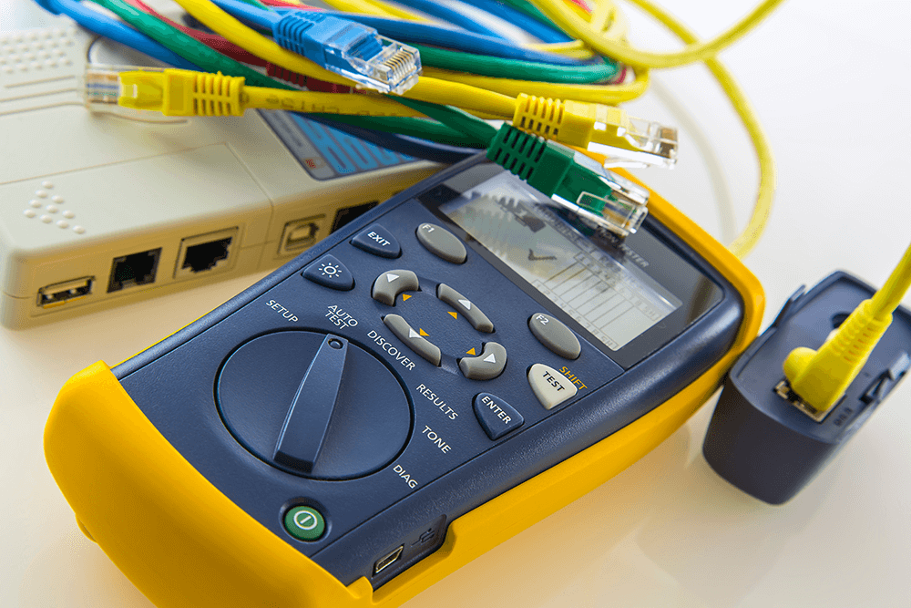

# Network Addressing and Basic Troubleshooting - Módulo 7   

### Cisco: <a href="../../../">cisco   </a>
### Cisco Networking Academy: cna   </a>
### Training Category: <a href="../../../self_paced/">self-paced</a>
### Software/Subject: network   </a>
### Course: <a href="../">sfp_009 (Network Addressing and Basic Troubleshooting)   </a>
### Module: 7. Solucionar problemas comuns de rede

---

### Theme:
- Network

### Used Tools:
- Operating System (OS): 
  - Windows 11 
- Cloud Services:
  - Google Drive 
- Language:
  - HTML   
  - Markdown   
- Integrated Development Environment (IDE) and Text Editor:
  - Visual Studio Code (VS Code)   
- Versioning: 
  - Git   
- Repository:
  - GitHub   

---

### Course Module 7 Structure:
7. <a name="item07">Solucionar problemas comuns de rede</a> 
  7.1 <a href="#item07.01">Introdução</a> 
  7.2 <a href="#item07.02">O Processo de Solução de Problemas</a> 
  7.3 <a href="#item07.03">Problemas de camada física</a> 
  7.4 <a href="#item07.04">Solucionar problemas de redes sem fio</a> 
&nbsp;&nbsp;&nbsp;&nbsp;7.4.1 <a href="../../../pkt/files/pkt_071/">Packet Tracer - Solucionar problemas de uma Conexão Wireless</a> 
  7.5 <a href="#item07.05">Problemas comuns de conectividade com a Internet</a> 
&nbsp;&nbsp;&nbsp;&nbsp;7.5.1 <a href="../../../labs/files/lab_062/">Laboratório - Solucionar problemas usando utilitários de rede</a> 
  7.6 <a href="#item07.06">Suporte ao cliente</a> 
  7.7 Resumo Solução de Problemas Comuns de Rede 
  7.8 Exame de ponto de verificação: Dispositivos Cisco e solução de problemas de rede 

---

### Objective:
O objetivo do módulo é apresentado na introdução, que compõe o primeiro item do desenvolvimento.

### Folder Structure:
- [README.md](./README.md): Este documento de README, escrito em **Markdown**, descrevendo todo conteúdo realizado neste módulo.
- [0-aux](../0-aux/): Pasta auxiliar com imagens utilizadas na construção dos arquivos de README desse curso.

### Development:

<a name="item07.01"><h4>7.1 Introdução</h4></a>[Back to summary](#item07)

🛠️ Diagnóstico e Solução de Problemas de Conectividade   
Validar e testar uma nova infraestrutura é a etapa final para garantir o funcionamento correto da rede. Quando ocorrem falhas, o profissional deve aplicar métodos estruturados para isolar o problema, avaliando desde os cabos físicos até as conexões sem fio e os acessos externos à internet, utilizando também o suporte e recursos externos para restabelecer a comunicação.

🎯 Objetivo do módulo:   
- Aplicar métodos de diagnóstico para identificar, isolar e corrigir falhas básicas de conectividade na rede.

📘 Tópicos do módulo:   
- O processo de solução de problemas: Abordagens e metodologisas estruturadas para a detecção de falhas em redes.
- Problemas de camada física: Identificação e diagnóstico de falhas em cabos, conectores e mídias de transmissão.
- Solução de problemas de conectividade sem fio: Correção de falhas comuns em conexões wireless.
- Problemas comuns de conectividade com a Internet: Análise de interrupções no acesso a serviços e redes externas.
- Apoio ao cliente: Uso de documentações, fontes externas e recursos da internet como auxílio no diagnóstico de problemas.

<a name="item07.02"><h4>7.2 O Processo de Solução de Problemas</h4></a>[Back to summary](#item07)

🧠 O Processo de Resolução de Problemas (Troubleshooting)   
A resolução de problemas em redes de computadores, conhecida tecnicamente como troubleshooting, consiste em um ciclo estruturado de identificação, localização e correção de anomalias. Embora profissionais seniores frequentemente recorram ao instinto e ao histórico de vivências para correlacionar sintomas de forma rápida, a engenharia de redes preconiza a aplicação de métodos sistemáticos para isolar a causa raiz de um incidente com precisão.

Um dos pilares que sustenta a gestão de incidentes é a manutenção rigorosa da documentação. Um registro técnico eficiente deve catalogar de forma transparente:
- O comportamento do problema e os impactos observados.
- O inventário de todas as ações tomadas durante a investigação, incluindo os testes que não trouxeram resultados.
- O plano de ação aplicado para mitigar a falha e os mecanismos preventivos desenhados para impedir sua recorrência.

Estatísticas de governança de TI comprovam que documentar o histórico de falhas cria uma base de conhecimento vital para a empresa. Quando um problema análogo se manifesta no futuro, a equipe técnica pode consultar os registros anteriores para restaurar os serviços rapidamente.

Ao interceptar um novo chamado de falha, o primeiro passo operacional do analista é validar a existência da pane e mapear o raio de manobra do impacto (se a falha afeta um único host, um departamento inteiro ou o link de internet principal). Confirmado o incidente, inicia-se a coleta sistemática de informações através de um checklist de auditoria:
- Escopo do Sintoma: Coleta de relatos de usuários finais e logs de alarmes gerados pelos sistemas.
- Inventário de Hardware/Software: Mapeamento do fabricante, modelo do ativo, versão do firmware e release do sistema operacional (parâmetros críticos para identificar bugs conhecidos ou incompatibilidades).
- Topologia e Configuração: Inspeção dos diagramas lógicos e físicos, análise dos arquivos de configuração atuais (running-config) e histórico de logs gerados nos servidores Syslog.
- Histórico de Alterações: Auditoria de modificações recentes na infraestrutura ou nos aplicativos para checar se a falha foi introduzida por uma nova parametrização.

Em ambientes de grande porte, essa varredura inicial é otimizada por ferramentas complexas de monitoramento de rede, que coletam métricas de saúde dos ativos continuamente. Em redes menores, o técnico supre essa demanda através de entrevistas com os usuários afetados e coleta manual de logs nos próprios dispositivos.

🗺️ Abordagens Estruturadas Baseadas no Modelo OSI   
Uma vez consolidados os dados sobre a falha, o administrador adota uma estratégia de varredura balizada pelas camadas do modelo de referência OSI. A escolha da metodologia ideal depende diretamente da natureza visível do sintoma:

🔽 Estratégia Baixo para Cima (Bottom-Up)   
Neste modelo de varredura, a investigação é iniciada na Camada Física (Camada 1), subindo sequencialmente pelas demais divisões (Enlace, Rede, Transporte) até alcançar a camada de aplicação. É a metodologia mais indicada quando existem fortes indícios de falhas de hardware ou problemas de conectividade elétrica. Como a maior parcela dos incidentes de rede ocorre nas camadas inferiores (cabos rompidos, interfaces danificadas, erros de duplex), a abordagem Bottom-Up apresenta uma alta taxa de sucesso.

Sua desvantagem reside na morosidade: o técnico é obrigado a auditar uma vasta quantidade de interfaces, cabos e portas físicas antes de conseguir progredir para as camadas lógicas superiores, gerando um volume expressivo de registros documentais. O grande desafio dessa técnica é determinar por qual ponto físico da topologia iniciar a inspeção.

🔼 Estratégia Cima para Baixo (Top-Down)   
A análise inicia-se no topo do modelo OSI, inspecionando a Camada de Aplicação (interfaces de software do usuário) e descendo gradativamente em direção à infraestrutura de rede. Esse modelo é adotado para isolar problemas mais simples ou quando há clareza de que o hardware e o transporte de rede encontram-se íntegros, concentrando o foco em bugs de software, falhas de autenticação ou problemas em navegadores e clientes de e-mail.

A contrapartida dessa abordagem é a necessidade de validar exaustivamente os serviços locais e aplicações do host até descartar causas de software. Assim como no método anterior, o analista enfrenta o desafio de eleger por qual aplicação iniciar a linha de testes.

🔀 Estratégia Dividir para Conquistar (Divide-and-Conquer)   
A engenharia de suporte classifica este método como um dos mais eficientes para analistas com nível intermediário de experiência. O profissional avalia os sintomas coletados e faz uma dedução lógica para selecionar uma camada intermediária do modelo OSI (comumente a Camada 3 - Rede) para iniciar os testes.

A validação dessa camada-base gera um atalho no diagnóstico:
- Se o analista dispara um teste de ping contra o destino e obtém sucesso, ele comprova que a Camada 3 e todas as camadas situadas abaixo dela (Física e Enlace) estão operando perfeitamente. A investigação é direcionada exclusivamente para as camadas superiores (Transporte e Aplicação).
- Se o ping falhar, o técnico deduz imediatamente que o problema reside em um nível inferior, concentrando o esforço de suporte nas camadas Física e de Enlace.

🛠️ Técnicas Complementares de Diagnóstico   
Além das metodologias estruturadas pelo modelo conceitual OSI, os técnicos aplicam táticas focadas em agilidade e isolamento físico para restabelecer a operação da rede:

🎯 Siga o Caminho (Path Tracing)   
Esta técnica consiste em mapear a rota exata percorrida pelos pacotes IP desde o host de origem até a interface de destino através de utilitários como o traceroute. Uma vez desenhado esse caminho real, o analista estreita o escopo do troubleshooting, eliminando da investigação todos os switches, roteadores e links que não participam ativamente daquele fluxo de encaminhamento de pacotes. É uma abordagem essencial que geralmente atua de forma combinada com os outros métodos de suporte.

🔄 Substituição de Componentes   
Consiste em realizar a troca física imediata do ativo sob suspeita de pane por um componente de reserva idêntico e de funcionamento comprovado. Caso a rede restabeleça a operação normal após a permuta, valida-se o defeito do hardware removido; se o sintoma persistir, a causa raiz está alocada em outro ponto da malha.

Trata-se de uma tática excelente para contingência em pontos únicos de falha (como a queda do roteador de borda de uma empresa). Sob a ótica de negócios, é mais vantajoso trocar o hardware de forma ágil para restaurar o faturamento e os serviços, deixando para investigar os detalhes do bug no laboratório posteriormente. No entanto, se o incidente envolver falhas simultâneas em múltiplos dispositivos, a substituição pura pode mascarar o problema e dificultar o isolamento da causa.

📐 Análise de Divergências (Spot-the-Differences)   
Esta abordagem baseia-se na comparação minuciosa de perfis técnicos. O analista confronta arquivos de configuração, versões de firmware, parâmetros de hardware e processos ativos de um dispositivo que apresenta mau funcionamento contra um equipamento idêntico que está operando perfeitamente na mesma rede. Ao detectar divergências nas linhas de comando ou nas revisões de software, o técnico padroniza o ativo problemático para que fique idêntico ao modelo funcional. A fragilidade desse método é que ele pode mitigar o sintoma e colocar o link em operação sem expor claramente qual era a causa raiz da falha.

🎯 Palpite Qualificado (Educated Guess)   
Também conhecida popularmente no mercado como abordagem informal ou direta. Consiste em formular uma hipótese rápida sobre a falha baseando-se estritamente na correlação de sintomas visíveis. O índice de assertividade dessa técnica varia proporcionalmente ao nível de experiência do profissional: engenheiros seniores conseguem resolver incidentes complexos de forma quase instantânea ao associar o cenário atual a falhas idênticas solucionadas no passado. Para técnicos novatos, contudo, essa prática pode se tornar um processo aleatório de tentativas e erros que consome tempo e pode ampliar a gravidade do incidente.

🛠️ Diretrizes para Seleção do Método de Troubleshooting   
A escolha do método mais eficiente de resolução de problemas varia proporcionalmente de acordo com a natureza visível do incidente detectado na infraestrutura:
- Suspeita de lentidão ou queda em cabos/conectores: Adota-se a abordagem Bottom-Up (Baixo para Cima). A justificativa de engenharia orienta iniciar o isolamento estritamente pelos componentes físicos e elétricos da Camada 1 antes de checar parâmetros lógicos.
- Bugs em navegadores, clientes de e-mail ou sistemas de autenticação: Utiliza-se o método Top-Down (Cima para Baixo). Essa estratégia foca em isolar as regras e o comportamento do software aplicativo antes de despender tempo auditando o tráfego de pacotes na rede.
- Falha geral em enlaces compostos por múltiplos ativos intermediários: Emprega-se a técnica Divide-and-Conquer (Dividir para Conquistar). O analista executa testes rápidos, como o comando ping, para validar a Camada 3 e, com isso, descartar ou confirmar blocos inteiros de camadas do modelo OSI de uma só vez.
- Parada total de um ativo de borda crítico para a operação do negócio: Aplica-se a estratégia de Substituição de Componentes. A engenharia prioriza o restabelecimento ágil do link físico e a rápida retomada do faturamento da empresa antes de iniciar a perícia minuciosa do bug no laboratório.

A habilidade de executar um troubleshooting eficiente é uma competência desenvolvida progressivamente por meio da prática constante de laboratório e da vivência diária de campo. Cada incidente identificado, analisado e mitigado expande o repertório técnico e a bagagem de diagnósticos do profissional de tecnologia.

<a name="item07.03"><h4>7.3 Problemas de camada física</h4></a>[Back to summary](#item07)

🔌 Diagnóstico e Sintomas na Camada Física (Camada 1)   
Uma parcela expressiva das falhas e interrupções em infraestruturas de rede local está diretamente associada a anomalias físicas na Camada 1 do modelo OSI. Essa divisão trata estritamente dos componentes de hardware, conexões elétricas, ópticas e dos meios de transmissão que interligam os ativos, deixando de fora qualquer aspecto relacionado a softwares ou configurações lógicas.

Os incidentes mais recorrentes na Camada Física envolvem falhas básicas que, por vezes, são negligenciadas durante a triagem inicial:
- Equipamentos desligados da tomada ou sem alimentação elétrica adequada.
- Conectores de cabos de rede soltos ou mal travados nas portas RJ-45.
- Utilização de cabos de rede rompidos, com vias partidas ou com defeitos de fabricação.
- Emprego de tipos incorretos de cabeamento para a interconexão de ativos antigos.
- Falhas de hardware ou travamentos em pontos de acesso sem fio (Access Points).

A abordagem diagnóstica clássica de baixo para cima (Bottom-Up) determina que a primeira ação técnica seja validar a alimentação e o estado de energia de todos os ativos posicionados no caminho entre a origem e o destino. Isolar visualmente os cabos e garantir que estejam firmemente plugados e inseridos nas portas corretas evita o desperdício de tempo com investigações lógicas complexas de software.

👁️ O Uso dos Sentidos Humanos no Isolamento de Falhas   
Antes de recorrer a testadores de cabo avançados ou analisadores de protocolo, o profissional de infraestrutura pode utilizar os próprios sentidos biológicos como ferramentas preliminares de diagnóstico em campo:
- Visão: Funciona como o recurso primário para detectar cabos desconectados, portas trocadas por engano, conectores mecânicos danificados e cabos prensados ou esticados além do limite saudável. A visão é essencial para monitorar o comportamento das luzes indicadoras dos equipamentos.
- Tato: Permite ao técnico tatear o chassi dos equipamentos para identificar componentes sofrendo com superaquecimento anormal. O tato também ajuda a avaliar o funcionamento mecânico de ventoinhas e coolers de refrigeração; a ausência total de vibração ou a presença de uma trepidação excessiva são indicativos claros de falhas no ventilador.
- Audição: Utilizada para captar ruídos elétricos anômalos (como estalos de curto-circuito) ou alterações no zumbido padrão emitido pelas fontes de alimentação, unidades de disco rígido e sistemas de exaustão de ar do rack.
- Olfato: Atua como um detector de alta sensibilidade para componentes eletrônicos que atingiram temperaturas críticas. O cheiro de plástico, isolante ou silício queimado é característico e serve de alerta para desligar o circuito imediatamente, evitando danos catastróficos ao hardware.

🚦 Leitura de Status Através dos LEDs dos Ativos   
Seguindo a estratégia de análise da Camada Física, a inspeção visual dos LEDs (Diodos Emissores de Luz) posicionados nos painéis frontais dos equipamentos fornece um diagnóstico em tempo real sobre o estado operacional das interfaces.

Embora o código de cores e a disposição das luzes variem de acordo com as especificações de cada fabricante, a engenharia de redes adota alguns comportamentos padronizados para as chamadas luzes de link (Link Lights):
- LED Verde Sólido (Fixo): Indica que a interface detectou uma conexão física válida com o dispositivo parceiro na outra ponta do cabo (presença de sinal elétrico de link), mas não há tráfego de dados transitando no momento.
- LED Piscando Intermitentemente: Sinaliza o comportamento ideal de produção, indicando que a porta está ativa e que existe fluxo de quadros sendo transmitido e recebido com sucesso.
- LED Apagado (Sem Luz): Denota uma anomalia na Camada 1, cujas causas prováveis abrangem a ausência de um cabo conectado, falta de energia no dispositivo vizinho, porta desativada administrativamente no software do switch, falha física no circuito da placa de rede (NIC) ou cabo danificado.

Alerta de Segurança (WPS/QSS): Muitos roteadores sem fio trazem um botão e um LED dedicado para funções de configuração rápida de segurança (WPS ou QSS). Por possuírem vulnerabilidades de código amplamente conhecidas que permitem a invasão e o comprometimento da rede por agentes de ameaças, as boas práticas de segurança determinam desativar completamente esse recurso nos menus internos de gerenciamento do dispositivo.

📐 Boas Práticas e Engenharia de Cabeamento Metálico   
O sistema de cabeamento estruturado constitui a espinha dorsal de qualquer rede local estável. Erros cometidos durante a conectorização e o lançamento físico dos cabos estão entre os maiores geradores de instabilidade em links corporativos. Para mitigar essas falhas, as seguintes regras de engenharia devem ser observadas:
- Respeito aos Limites de Distância: As características físicas dos cabos de cobre de par trançado impõem um teto máximo de alcance de 100 metros por segmento. Ultrapassar essa distância degrada o sinal elétrico pela atenuação e inviabiliza o estabelecimento estável do link.
- Terminação Padronizada e Precisa: A clipagem das pontas do cabo UTP nos conectores RJ-45 deve seguir rigorosamente as pinagens normatizadas T568A ou T568B. Durante a montagem, o técnico deve evitar destrançar os pares de fios além do limite estritamente necessário para o encaixe nos pinos, pois a remoção da trança quebra o efeito de cancelamento e gera diafonia (ruído).
- Alívio de Tensão Mecânica: A capa plástica externa protetora do cabo deve ser introduzida até o fundo do conector e firmemente prensada pela trava interna. Isso garante o alívio de tensão mecânica, impedindo que os fios internos de cobre sofram tração ou se soltem com o manuseio.
- Mitigação de Danos Físicos: Os cabos devem ser lançados por dentro de calhas, eletrodutos ou fixados em organizadores apropriados, mantendo-os fora de rotas de passagem de pessoas ou áreas de pressão. O uso de suportes de fixação adequados evita que o peso do próprio chicote de cabos exerça força excessiva sobre os conectores e portas físicas dos switches, preservando a integridade da Camada 1 a longo prazo.

<a name="item07.04"><h4>7.4 Solucionar problemas de redes sem fio</h4></a>[Back to summary](#item07)

📡 Variáveis Físicas e Desafios de Conectividade em Radiofrequência (RF)   
Diferente das infraestruturas cabeadas, onde os elétrons e fótons trafegam por meios físicos confinados, as redes sem fio locais (WLANs) dependem da propagação de ondas eletromagnéticas no espaço livre para o transporte de dados. A invisibilidade do meio de transmissão faz com que a conectividade entre as estações clientes e os Pontos de Acesso (Access Points - APs) seja influenciada por uma série de fatores físicos e ambientais:
- Incompatibilidade de Padrões: A tecnologia Wi-Fi evolui através de diferentes emendas do padrão IEEE 802.11, que operam em faixas de frequências distintas. Equipamentos configurados exclusivamente para operar sob a norma 802.11ac (que utiliza a banda de 5 GHz) são fisicamente incapazes de conversar com dispositivos legados baseados nos padrões 802.11b ou 802.11g (restritos à banda de 2,4 GHz). Mesmo dentro da mesma faixa de frequência, técnicas de modulação diferentes podem impedir a conectividade, exigindo que o administrador configure explicitamente o AP em modo misto ou de retrocompatibilidade para acolher hardware antigo.
- Planejamento e Sobreposição de Canais: O espectro de radiofrequência é dividido em canais numéricos. Para que uma comunicação flua sem erros, o AP e o cliente devem sintonizar a mesma frequência, e essa célula deve operar idealmente em um canal livre de sobreposição com os APs vizinhos. Embora a maioria dos roteadores sem fio modernos traga rotinas de escolha automática de canais baseadas na leitura de congestionamento do ambiente, ambientes corporativos complexos exigem o mapeamento e a fixação manual desses canais para mitigar interferências.
- Atenuação e Perda de Propagação: A intensidade dos sinais de RF sofre uma degradação natural e exponencial à medida que a distância entre o host e o emissor aumenta. Barreiras físicas (como paredes de alvenaria, vidros e estruturas metálicas) absorvem e refletem as ondas, reduzindo drasticamente o indicador de nível de sinal (RSSI). Se a potência cair abaixo do limiar de recepção da placa de rede (NIC), o host perde a capacidade de associação. O técnico pode diagnosticar esse comportamento inspecionando os utilitários de software da própria placa cliente, que exibem gráficos de qualidade do link e potência em tempo real.
- Fontes de Interferência Externa: A banda de 2,4 GHz é um espectro não licenciado densamente saturado, sujeito a ruídos gerados por dispositivos externos que compartilham a mesma frequência, como telefones sem fio analógicos, babás eletrônicas, dispositivos Bluetooth e até fornos de micro-ondas em funcionamento. Para isolar esses vilões invisíveis, engenheiros realizam um procedimento chamado Site Survey (varredura de local) utilizando analisadores de espectro para mapear o nível de ruído de fundo do ambiente.
- Saturação e Compartilhamento de Meio: Os APs operam como hubs sem fio em modo Half-Duplex, o que significa que a largura de banda total disponível no canal é compartilhada de forma agregada entre todas as estações associadas àquela célula. À medida que o número de smartphones e computadores conectados ao mesmo AP cresce, a fatia de tempo de transmissão (airtime) dedicada a cada host diminui proporcionalmente, degradando a performance geral da rede. A solução de engenharia para esse gargalo envolve o balanceamento de carga, reduzindo a densidade de clientes por rádio através da instalação de APs adicionais operando em canais distintos.

🔒 Parâmetros Lógicos de Configuração e Erros Comuns   
Mesmo que a Camada Física do rádio apresente excelentes níveis de sinal e ausência de interferências, a conectividade fim a fim pode ser completamente bloqueada por falhas de parametrização lógica nos softwares dos dispositivos. Os três principais pontos de erro na configuração de segurança de uma WLAN envolvem:

🆔 Identificador do Serviço (SSID)   
O SSID consiste no nome alfanumérico de até 32 caracteres que identifica a rede sem fio. Este parâmetro possui a característica estrita de diferenciar letras maiúsculas de minúsculas (case-sensitive). Para que a associação ocorra, o SSID configurado no perfil do cliente deve ser exatamente idêntico ao registrado no AP.

Quando o AP é configurado para ocultar a transmissão do SSID (SSID Broadcasting Disabled), a rede deixa de aparecer nas buscas automáticas dos dispositivos. Nesse cenário, o usuário é obrigado a criar o perfil de conexão inserindo o nome da rede de forma manual e precisa; qualquer erro de digitação impedirá o fechamento do link. Além disso, se houver um AP vizinho (ou malicioso) propagando o mesmo SSID com sinal mais forte, o dispositivo do cliente pode se associar automaticamente a ele de forma inadvertida.

🔑 Mecanismos de Autenticação   
A autenticação valida a identidade do dispositivo antes de conceder o acesso ao meio de transmissão. Por padrão, muitos APs residenciais trazem de fábrica o modo de Autenticação Aberta (Open), que permite a associação imediata de qualquer host sem a exigência de credenciais.

Em ambientes protegidos, utilizam-se métodos de segurança robustos (como WPA2 ou WPA3) que exigem o compartilhamento de chaves ou senhas criptográficas. Se o cliente e o AP divergirem no método escolhido ou utilizarem chaves que não coincidam caractere por caractere, o processo de handshake falhará na Camada 2 e o dispositivo será sumariamente desconectado pelo AP.

🔐 Protocolos de Criptografia   
Enquanto a autenticação controla a entrada na rede, a criptografia oculta os dados em trânsito, embaralhando os pacotes de rádio para que terceiros não consigam interceptar as informações sem possuir a chave decodificadora adequada.

Um sintoma clássico de erro nessa camada ocorre quando o computador do usuário conclui com sucesso o processo de associação ao AP, ganha um endereço IP, exibe o status de conectado, mas permanece totalmente impossibilitado de enviar ou receber pacotes de dados na rede. Esse cenário indica de forma crônica um desalinhamento ou incompatibilidade nos algoritmos de criptografia (como um dispositivo tentando operar em AES enquanto o outro espera chaves TKIP), fazendo com que o AP receba os quadros do host mas os descarte por não conseguir descriptografar o conteúdo.

<a name="item07.05"><h4>7.5 Problemas comuns de conectividade com a Internet</h4></a>[Back to summary](#item07)

🖥️ Diagnóstico Lógico e Validação da Configuração IP do Cliente   
Quando os testes de Camada Física (Camada 1) e de Enlace (Camada 2) atestam que os computadores locais estão conectados eletricamente e associados à rede sem fio, mas o tráfego falha ao tentar alcançar redes remotas ou a internet, o foco da investigação deve migrar para a parametrização lógica da Camada de Rede (Camada 3).

Em redes locais de pequeno e médio porte, o roteador atua centralizadamente como um servidor DHCP (Dynamic Host Configuration Protocol). Ele é o responsável por automatizar o provisionamento lógico dos hosts, distribuindo um pacote de quatro informações fundamentais:
- Um endereço IP exclusivo dentro do escopo local.
- A máscara de sub-rede correspondente.
- O endereço de gateway padrão (que aponta para a interface LAN do próprio roteador).
- Os endereços IP dos servidores DNS para resolução de nomes.

O serviço DHCP opera associando temporariamente o endereço IP fornecido ao endereço físico MAC da placa de rede do cliente, registrando esse vínculo em uma tabela de concessões (DHCP Leases). O administrador pode auditar essa tabela acessando a interface gráfica (GUI) do roteador para validar quais dispositivos receberam IPs. Para confrontar se o computador herdou os parâmetros corretamente, utiliza-se o comando `ipconfig /all` no prompt de comando do Windows.

Durante a auditoria, o analista deve certificar-se de duas regras de consistência:
- O IP do cliente deve residir obrigatoriamente no mesmo segmento lógico e sub-rede da interface LAN do roteador.
- O endereço IP do roteador deve constar exatamente no campo de gateway padrão do host.

Caso os dados exibidos no computador divirjam dos registros do roteador ou apresentem inconformidades (como o recebimento de um IP inválido de autoconfiguração), o vínculo deve ser quebrado e restabelecido. Na linha de comando do cliente, executa-se o comando `ipconfig /release` para liberar a concessão atual, seguido do comando `ipconfig /renew` para forçar uma nova requisição DHCP ao roteador e atualizar as configurações lógicas.

🌐 Validação do Link de Borda e Conectividade com o ISP   
Se o diagnóstico comprovar que todas as estações internas conseguem se comunicar perfeitamente entre si e respondem aos pings direcionados à interface LAN do roteador, mas permanecem completamente isoladas da internet, o ponto de falha desloca-se da rede interna para a interface WAN do roteador, que faz a fronteira com o Provedor de Serviços de Internet (ISP).

Na maioria dos contratos residenciais e corporativos de entrada, a interface WAN do roteador também atua como um cliente DHCP, aguardando que os servidores da operadora forneçam um endereço IP público roteável. O administrador deve acessar o painel de gerenciamento web do roteador e inspecionar a página de status do sistema para verificar se a interface WAN possui uma identidade IP válida atribuída pelo provedor.

Caso o painel do roteador acuse um status de desconectado ou exiba um endereço zerado na interface WAN, o analista deve adotar os seguintes procedimentos de isolamento:
- Auditoria Física Externa: Inspecionar os cabos que interligam a porta WAN do roteador ao modem de banda larga (seja ele de fibra óptica, cabo ou DSL) e checar os LEDs indicadores de link do modem.
- Validação de Credenciais de Acesso: Se o provedor exigir autenticação na linha (como o protocolo PPPoE), deve-se revisar se o nome de usuário e a senha de acesso gravados na página de configuração do roteador estão corretos e sem erros de digitação.
- Forçar Renovação WAN: Utilizar os botões da própria interface gráfica do roteador para disparar uma liberação e renovação do endereço IP público na porta WAN.

Se após todas as verificações de hardware, cabos e credenciais o roteador permanecer incapaz de obter um IP público da operadora, conclui-se que a falha reside em uma interrupção de sinal ou manutenção do próprio provedor de internet, sendo necessário abrir um chamado de suporte com o ISP.

🔒 Filtros de Camadas Superiores e Regras de Segurança   
Quando as Camadas de 1 a 3 encontram-se em pleno funcionamento — cenário comprovado quando o técnico consegue disparar um teste de ping bem-sucedido a partir de um host local contra o endereço IP de um servidor público na internet —, mas os aplicativos ou sites específicos continuam falhando em carregar, a causa raiz do incidente reside nas camadas superiores do modelo OSI (Camadas de Transporte e Aplicação).

Nesse nível de diagnóstico, o tráfego de dados pode estar sofrendo bloqueios por regras restritivas de segurança implantadas no caminho:
- Firewalls de Rede e Ativos de Segurança: É necessário verificar as listas de controle de acesso (ACLs) do roteador ou dos firewalls de perímetro da empresa para atestar se as portas lógicas TCP ou UDP exigidas pelo aplicativo estão abertas e liberadas para tráfego. Um bloqueio na porta TCP 443, por exemplo, impedirá o acesso a sites seguros (HTTPS), mesmo que o ping funcione.
- Políticas de Isolamento Interno: Caso os computadores possuam IPs corretos, acessem a internet, mas fiquem impedidas de conversar e pingar umas às outras dentro da própria LAN, o roteador pode estar aplicando regras internas de restrição, como o recurso de isolamento de clientes (Client Isolation), comum em redes Wi-Fi de visitantes para impedir a comunicação lateral.
- Firewalls Locais dos Dispositivos: O analista de suporte deve inspecionar os softwares de segurança internos e os firewalls nativos dos próprios sistemas operacionais dos hosts clientes (como o Windows Defender Firewall). Configurações excessivamente rígidas ou perfis de rede configurados incorretamente como "Público" em vez de "Privado" podem fazer com que o sistema operacional bloqueie o tráfego de entrada e ignore requisições legítimas de rede, simulando uma falha de conectividade física.

🔀 Isolamento e Diagnóstico de Conectividade Mista   
Em infraestruturas que integram segmentos com e sem fio, as falhas de comunicação podem ter origem em qualquer uma das mídias. Para evitar o desperdício de tempo, a estratégia de Dividir para Conquistar é a mais indicada para isolar se a falha reside no domínio físico do cabo ou no espectro de radiofrequência.

O isolamento do problema é feito de forma simples através de uma sequência de testes de ping:
- Do host sem fio para o gateway padrão: Valida se a associação Wi-Fi e a comunicação com o roteador estão operantes.
- Do host cabeado para o gateway padrão: Valida se o cabo, conectores e a porta física do switch/roteador estão operantes.
- Do host sem fio para o host cabeado: Valida se o roteador está realizando a ponte de tráfego e o encaminhamento interno entre as duas mídias conforme o esperado.

🛠️ Utilitários de Diagnóstico no Prompt do Windows   
Embora o ping seja a ferramenta mais comum para testar a conectividade fim a fim, ele apenas informa se o destino respondeu ou não, sem apontar onde o fluxo de dados foi interrompido. Para uma auditoria detalhada, o sistema Windows disponibiliza outros comandos nativos:

🎯 O Comando tracert   
Este utilitário (chamado de traceroute em outras plataformas) mapeia o caminho exato que o pacote percorre até o destino, listando cada roteador (salto/hop) intermediário. Ele exibe o tempo de ida e volta (Round-Trip Time) para cada salto, ajudando a localizar pontos de perda de pacotes, gargalos e lentidões na rede.

O trajeto obtido é exclusivo para cada consulta e varia em extensão e nós visitados. Caso um dos saltos exiba falha de resposta, isso geralmente indica que o firewall daquele roteador específico foi programado para ignorar as sondagens do utilitário, embora ele continue encaminhando o pacote normalmente para o salto seguinte. Por padrão, o comando interrompe a busca ao atingir o limite de 30 saltos, teto que pode ser customizado adicionando o parâmetro -h. Opções extras de teste podem ser consultadas no prompt.

🔌 O Comando netstat   
Utilizado para inspecionar e listar todas as conexões TCP ativas em execução no computador. A saída do comando discrimina o protocolo em uso, os endereços e portas locais, os endereços e portas externos, além do estado atual de cada sessão.

Monitorar esses dados é uma prática de desempenho e segurança. Conexões TCP ativas de origem desconhecida podem sinalizar invasões ou softwares maliciosos operando no host, enquanto sessões desnecessárias abertas consomem recursos de hardware e degradam a performance do sistema. A sintaxe `netstat /?` exibe todos os modificadores de filtragem disponíveis para o comando.

🔍 O Comando nslookup   
O funcionamento das aplicações na internet depende do sistema DNS para converter nomes de domínios em endereços IP numéricos legíveis para as máquinas. Quando essa resolução falha, o utilitário nslookup permite que o técnico consulte manualmente os servidores de nome configurados (cujos IPs geralmente são fornecidos pelo ISP).

Ao ser executado, o comando exibe imediatamente o nome e o IP do servidor DNS padrão do host. A partir do seu prompt, o analista pode testar a resolução de nomes de hosts específicos e auditar o status dos servidores de consulta, contando com parâmetros avançados de verificação contidos em seu menu de opções.

<a name="item07.06"><h4>7.6 Suporte ao cliente</h4></a>[Back to summary](#item07)

🌐 Fontes de Consulta e Apoio Externo no Troubleshooting   
Quando os procedimentos internos de diagnóstico não são suficientes para isolar ou mitigar uma falha na infraestrutura de rede, o analista deve recorrer a canais de apoio externos. O acionamento dessas fontes economiza tempo e direciona a investigação para resoluções já validadas pelo mercado.

As principais vertentes de auxílio técnico incluem:
- Documentação Oficial: Manuais, guias de engenharia e especificações técnicas fornecidos pelos fabricantes. São essenciais para validar o comportamento nominal do hardware, embora possam carecer de detalhes em cenários de alta complexidade.
- Bases de FAQs e Centrais de Ajuda: Seções de perguntas frequentes mantidas nos portais dos fabricantes. Elas compilam resoluções para os incidentes mais reportados pelas comunidades globais de usuários, funcionando como um repositório ágil de soluções atuais.
- Fóruns e Comunidades Técnicas: Consultas em ecossistemas de discussão na internet permitem interagir com profissionais de todo o mundo em tempo real, fornecendo visões práticas sobre problemas específicos ou bugs de plataformas.
- Interação com Pares (Colegas de Trabalho): A troca de impressões com outros especialistas do time agrega valor imediato à investigação, visto que a experiência acumulada por parceiros de equipe é um ativo insubstituível no diagnóstico de falhas.

📞 Acionamento de Suporte e Níveis de Escalonamento   
Se a falha persistir após as consultas iniciais, torna-se mandatório abrir um chamado técnico junto ao fornecedor do hardware (como o TAC da Cisco) ou com o Provedor de Serviços de Internet (ISP). A central de atendimento (help desk ou support desk) atua como a primeira linha de defesa, disponibilizando analistas munidos de ferramentas especializadas para diagnosticar e mitigar o incidente.

O contato com a engenharia de suporte deve ser calibrado de acordo com o impacto financeiro ou operacional da pane. Canais em tempo real, como chamadas telefônicas ou salas de bate-papo ao vivo (live chat), são estritamente reservados para incidentes críticos e urgentes — comuns em ambientes bancários ou data centers, onde minutos de inatividade geram prejuízos massivos. Para demandas de baixa prioridade ou dúvidas operacionais, o encaminhamento via e-mail é o fluxo padrão.

Para otimizar o atendimento, a equipe de suporte pode solicitar a inicialização de softwares de acesso remoto. Essa tecnologia concede o controle do terminal local ao especialista do fornecedor, permitindo que ele execute rotinas avançadas de diagnóstico e colete logs diretamente na infraestrutura, eliminando o tempo de deslocamento físico e agilizando a restauração dos serviços.

As estruturas de suporte técnico corporativo são organizadas sob um modelo de escalonamento fundamentado em níveis de especialização:
- Suporte de Nível 1 (L1): Equipe de recepção encarregada de realizar o atendimento inicial, conduzir checklists de triagem, coletar o inventário do cenário e resolver incidentes comuns e documentados.
- Suporte de Nível 2 (L2) e Superiores: Caso o time L1 não consiga sanar a falha, o chamado é escalado. Os analistas de níveis seniores possuem maior senioridade técnica, amplo domínio da arquitetura e retêm o privilégio de uso de ferramentas proprietárias de depuração e diagnóstico aprofundado.

📝 O Fluxo do Chamado: Tíquetes e Ordens de Serviço   
A abertura de um incidente dispara um processo padronizado de registro e gerenciamento de informações que acompanha o ciclo de vida da falha desde o primeiro contato até a sua efetiva resolução.

No momento em que o atendimento é iniciado, o analista localiza o perfil da empresa em um banco de dados de gerenciamento de clientes. Na sequência, todas as variáveis do incidente são transpostas para um registro formalizado, denominado tíquete de problema ou relatório de incidente. Este documento eletrônico funciona como o prontuário da falha: cada técnico que assume o caso é obrigado a registrar detalhadamente as hipóteses testadas, os comandos executados e os resultados obtidos.

Caso o diagnóstico remoto aponte a necessidade de uma intervenção em campo, os dados consolidados no tíquete são convertidos em uma ordem de serviço (OS). Esse documento orienta o técnico que se deslocará até as instalações do cliente sobre o histórico da pane e os componentes sob suspeita de defeito.

📋 Boas Práticas de Interação e Coleta de Dados   
Para garantir um atendimento ágil e assertivo ao acionar o suporte de um fabricante, o profissional da ponta do cliente deve estar posicionado fisicamente próximo ao hardware afetado e ter em mãos um dossiê completo contendo:
- Dados Contratuais: Número do plano de suporte, contrato de manutenção (SmartNet ou similar) ou dados de garantia do produto.
- Identificação do Hardware: Marca, modelo exato, número de série e as versões atuais de firmware ou do sistema operacional (Cisco IOS) que rodam no chassi.
- Dados de Rede: Mapa de endereçamento IP e os endereços MAC das interfaces envolvidas no incidente.

Adicionalmente, o analista deve documentar as respostas para as cinco perguntas fundamentais que guiam a perícia do suporte:
- Quais foram os sintomas e mensagens de erro capturados?
- Quem identificou a anomalia na infraestrutura?
- Em que data e horário exato o problema se manifestou pela primeira vez?
- Quais passos práticos foram executados internamente para isolar a falha?
- Quais foram os resultados gerados por essas ações de testes?

Caso a interação seja um desdobramento de um atendimento anterior, o profissional deve fornecer de imediato o número do tíquete existente, o nome do último analista responsável e o histórico de datas.

Todo o fluxo de conversação, decisões acordadas, códigos de analistas e horários devem ser minuciosamente anotados pelo cliente. Assim que o suporte concluir o caso e o link for restabelecido, o administrador da rede deve realizar o fechamento do ciclo atualizando toda a documentação interna da empresa e registrando o aprendizado na base de conhecimento local para consultas futuras.